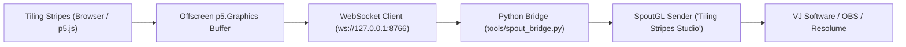

# Spout Bridge Runner & Video Streamer

This skill guides the management of real-time Spout output streaming for `tiling_stripes`.

---

## 1. Architecture Overview



* **Offscreen Buffer:** Clean frame rendered at native artboard resolution (no pan, zoom, rulers, hover badges, or UI overlays).
* **Frame Deduplication:** `artifactSignature` prevents redundant transmits when canvas content has not changed.
* **Bridge Script:** Located in [`tools/spout_bridge.py`](../../tools/spout_bridge.py).

---

## 2. Launching the Bridge

On Windows, launch the bridge using the bundled batch script (runs outside sandbox):

```cmd
tools\spout_bridge.cmd
```

Alternatively, run directly with Python 3.12:
```powershell
& "$env:LOCALAPPDATA\Programs\Python\Python312\python.exe" -u tools/spout_bridge.py
```

Wait until the bridge outputs:
```text
[spout] ponte ouvindo em ws://127.0.0.1:8766
[spout] remetente Spout ativo: Tiling Stripes Studio
```

---

## 3. Automated Validation

Validate the Spout output logic without needing a physical Spout receiver:

```powershell
node tests/test_spout_output.js
```

This verifies:
1. Sender name sanitization.
2. `artifactSignature` change detection and discard behavior.
3. Frame packet structure and payload integrity.
