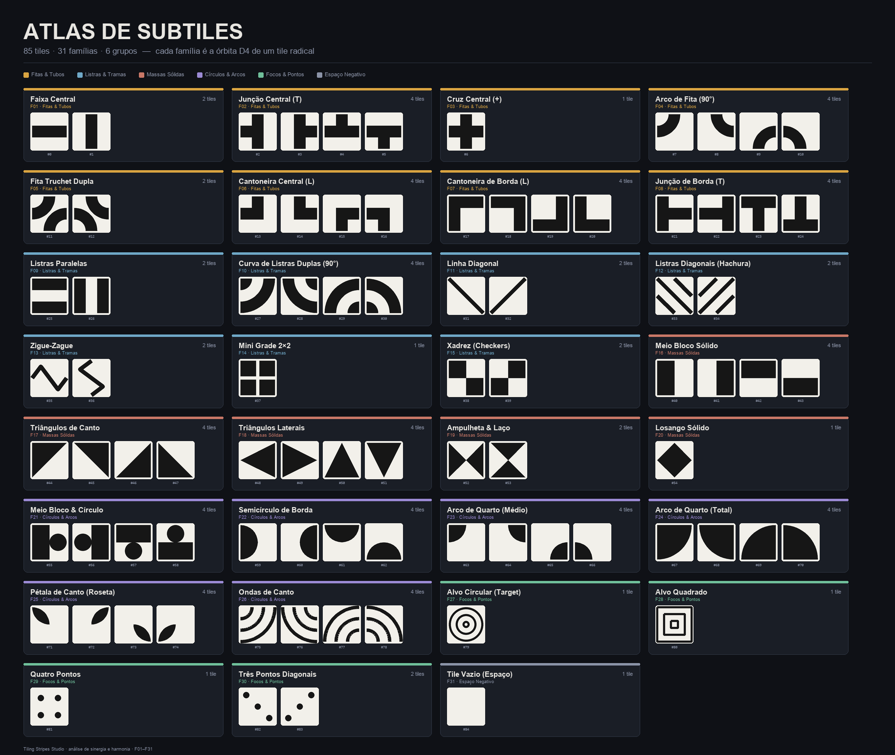
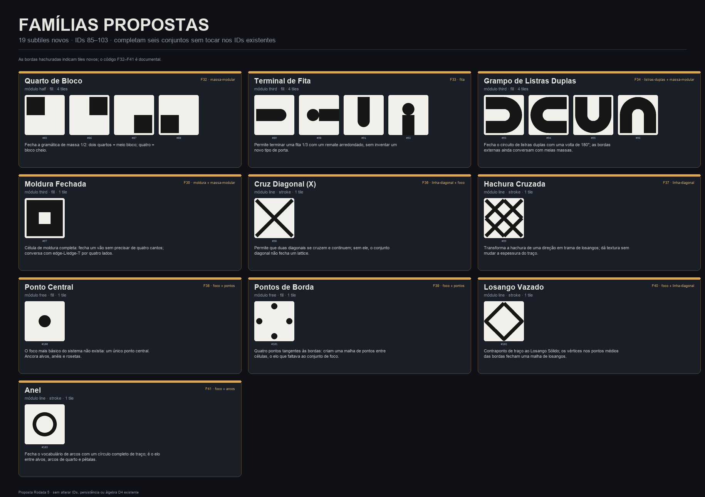

# Análise dos Subtiles — Famílias, Conjuntos, Sinergia e Harmonia

**Aplicação:** Tiling Stripes Studio
**Escopo:** catálogo vetorial de `core/tile_registry.js` (85 subtiles, 31 famílias, 6 grupos)
**Rodada:** proposta de expansão para a Rodada 5
**Documento de implementação:** [`INSTRUCOES_GEMINI_RODADA5.md`](../instrucoes/INSTRUCOES_GEMINI_RODADA5.md)

---

## 0. Resumo executivo

1. **O catálogo não tem um problema de quantidade: tem um problema de gramática.** 85 tiles já cobrem muita coisa, mas apenas **quatro gramáticas de borda** explicam quase toda a sinergia real: faixa central de 1/3 (**C**), borda cheia (**F**), metade de 1/2 (**H**) e duas faixas externas de 1/3 (**D**). O resto são traços, pontos e vazios.
2. **A sinergia é altamente concentrada.** `Junção de Borda (T)` tem grau estrutural 19; `Meio Bloco`, `Meio Bloco & Círculo` têm 13; `Cantoneira de Borda (L)` e `Listras Paralelas` têm 12. Nove famílias não conectam estruturalmente (ou conectam só a si mesmas).
3. **Algumas famílias são pontes e já pertencem a mais de um conjunto.** `Junção de Borda (T)` é a ponte natural entre **Fita** e **Moldura** (tem portas C, F e O). `Cantoneira de Borda (L)` é ponte entre **Moldura** e **Massa**. `Listras Paralelas` é ponte entre **Listras Duplas** e **Moldura**. `Meio Bloco & Círculo` é ponte entre **Massa** e **Arcos**. Isso confirma a intuição do enunciado: conjunto não é partição.
4. **Há falsos amigos de sinergia.** O `Alvo Circular` tangencia as quatro bordas e o algoritmo o lê como uma porta C; o `Alvo Quadrado` tem borda cheia, mas é um traço fino; as `Ondas de Canto` tangenciam a borda oposta e imitam uma faixa de 1/3. São compatibilidades de *cobertura*, não de *matéria*.
5. **A harmonia não pede uniformidade global.** Pede **coerência por conjunto**: 1/3 com 1/3, 1/2 com 1/2, traço com traço, massa com massa. O atrito aparece quando o gerador mistura módulos e materiais sem uma família-ponte.
6. **Proposta:** 9 conjuntos sobrepostos + **10 famílias novas** (19 subtiles, IDs **85–103**), sem tocar nos IDs existentes: `Quarto de Bloco`, `Terminal de Fita`, `Grampo de Listras Duplas`, `Moldura Fechada`, `Cruz Diagonal (X)`, `Hachura Cruzada`, `Ponto Central`, `Pontos de Borda`, `Losango Vazado`, `Anel`.
7. **Ajustes de harmonia:** normalizar o traço fino em 0,10; recuar o `Alvo Circular` para deixar de fingir que é conector; documentar os falsos amigos; corrigir um comentário de numeração; acrescentar metadados de conjunto; expor “Conjuntos” como lente de curadoria, nunca como regra do gerador.

**Números-âncora**

| Métrica | Valor |
|---|---|
| Subtiles existentes | 85 (IDs 0–84) |
| Famílias D4 existentes | 31 |
| Órbitas: 1 / 2 / 4 tiles | 7 / 9 / 15 famílias |
| Lados de tile analisados | 340 |
| Lados com matéria estrutural | 212 |
| Lados vazios ou só com contato pontual | 128 |
| Classes de porta estruturais | 5 famílias (C, F, H, O, D) em 7 variantes posicionais |
| Componente estrutural gigante | 22 famílias |
| Famílias-ilha | 9 |
| Subtiles propostos | 19 (IDs 85–103) |
| Total proposto | 104 subtiles, 41 famílias |

---

## 1. Definições operacionais

### 1.1 Subtile, tile radical e família

- **Subtile** é a célula mínima renderizada: um quadrado com um renderer vetorial indexado.
- **Tile radical** é o representante canônico de uma forma, antes de orientar.
- **Família** é a órbita do radical sob o grupo D4 (8 isometrias do quadrado: 4 rotações + 4 reflexões). Na prática, é o conjunto de orientações que o app cicla com `[` e `]` e que o mapa `TILE_D4_MAP` fecha.

> **Observação sobre “rotação”:** o enunciado define família como “a rotação de um tile radical”. O app usa D4, então uma família pode incluir também a imagem espelhada quando o radical é quiral (ex.: `Linha Diagonal` tem duas orientações que não são obtidas só por rotação). Isso não contradiz a definição: a família é a órbita de orientações; o grupo que a fecha é D4. A vantagem é que qualquer membro pode ser transformado em qualquer outro por uma das 8 isometrias.

Órbitas existentes:

| Tamanho da órbita | Famílias | Total de tiles |
|---|---|---|
| 1 (invariante sob D4) | Cruz Central, Mini Grade, Losango, Alvo Circular, Alvo Quadrado, Quatro Pontos, Vazio | 7 |
| 2 (eixo ou diagonal) | Faixa Central, Truchet, Listras, Linha Diagonal, Hachura, Zigue-Zague, Xadrez, Ampulheta, Três Pontos | 18 |
| 4 (quiral/assimétrica) | Junção T, Arco de Fita, Cantoneira Central, Cantoneira de Borda, Junção de Borda, Curva de Listras, Meio Bloco, Triângulos de Canto, Triângulos Laterais, Meio Bloco & Círculo, Semicírculo, Arco Médio, Arco Total, Pétala, Ondas | 60 |
| **Total** | **31 famílias** | **85 tiles** |

### 1.2 Conjunto

**Conjunto** é um agrupamento de famílias que *se encaixam bem*. Não é uma partição, não é uma pasta fechada e não é uma regra de geração:

- uma família pode participar de **vários** conjuntos, com papéis diferentes;
- um conjunto pode ter **subconjuntos** e sobreposições;
- um conjunto pode ser **estrutural** (as bordas continuam) ou **rítmico** (os motivos se alinham sem continuidade de matéria);
- o mesmo tile pode ser `núcleo` num conjunto e `ponte`/`acento` em outro.

Papéis usados nesta análise:

| Papel | Significado |
|---|---|
| **núcleo** | define a gramática do conjunto; sem ele o conjunto não existe |
| **ponte** | compartilha portas com dois ou mais conjuntos; é o que permite misturar |
| **terminal** | fecha ou remata uma malha (cap, U-turn, anel) |
| **acento** | entra bem em pequenas doses, mas não sustenta o conjunto sozinho |
| **textura** | contribui com ritmo/densidade, não com continuidade |
| **tangente** | encosta na borda por tangência; parece conectar, mas é outro material (falso amigo) |

### 1.3 Sinergia × harmonia

| Eixo | Pergunta | Como foi medido |
|---|---|---|
| **Sinergia** | “estas famílias conseguem se encaixar?” | perfil de portas por lado, grafo de encaixes estruturais, fechamento do conjunto |
| **Harmonia** | “estas famílias parecem pertencer à mesma linguagem?” | módulo (1/3, 1/2, traço, livre), material (cheio, traço, vazio), densidade de tinta, espessura de traço |

Um par pode ter **sinergia sem harmonia** (Alvo Circular × Fita: a cobertura combina, o material não) e **harmonia sem sinergia** (Quatro Pontos × Pétala: o ritmo combina, as bordas não se tocam). O objetivo não é maximizar os dois em todo o catálogo; é **escolher o eixo certo para cada conjunto**.

---

## 2. Inventário e classificação



### 2.1 Como ler as portas

Cada lado do tile é amostrado em 1.024 pontos, 1 unidade dentro da borda. O perfil é o conjunto de intervalos cobertos por tinta, normalizado de 0 a 1 ao longo do lado (esquerda→direita, topo→base).

| Símbolo | Classe | Intervalo típico | Onde aparece |
|---|---|---|---|
| **∅** | vazio | — | espaços, focos, lados não usados |
| **C** | faixa central de 1/3 | `[1/3, 2/3]` | Fita, Cruz, T, Truchet, Alvo Circular (falso) |
| **F** | borda cheia | `[0, 1]` | Meio Bloco, Moldura, Alvo Quadrado, Semicírculo |
| **H0 / H1** | metade | `[0, 1/2]` / `[1/2, 1]` | Meio Bloco, Xadrez, Arco Médio, Meio Bloco & Círculo |
| **O0 / O1** | terço externo | `[0, 1/3]` / `[2/3, 1]` | Cantoneira de Borda, Junção de Borda |
| **D** | dois terços externos | `[0,1/3] ∪ [2/3,1]` | Listras, Curva de Listras, Grampo |
| **S** | traço fino | banda estreita em posição variável | Linha, Hachura, Zigue-Zague, Ondas |
| **P** | contato pontual | ponto (canto ou meio) | Losango, Pétala, Pontos, Triângulos |
| **G** | grade com gap | `[0,0.45] ∪ [0.55,1]` | Mini Grade 2×2 |
| **T** | tangente | banda larga por tangência | Alvo Circular, Ondas de Canto |

Distribuição nos 85 tiles (212 lados com matéria):

| Classe | Lados | % dos lados ativos |
|---|---:|---:|
| C | 52 | 24,5% |
| F | 56 | 26,4% |
| H0 + H1 | 32 | 15,1% |
| O0 + O1 | 24 | 11,3% |
| D | 12 | 5,7% |
| S | 36 | 17,0% |

**Leitura:** C + F + H = **66%** dos lados ativos. O catálogo é dominado por três gramáticas; O e D são especializações; S é uma linguagem à parte. Isso explica por que a mistura aleatória de famílias frequentemente produz atrito: o gerador escolhe entre gramáticas que não têm portas em comum.

> Os números brutos incluem falsos amigos (Alvo Circular como C, Alvo Quadrado como F, Ondas como O). A seção 3.3 desconta esses casos.

### 2.2 Tabela das 31 famílias

Colunas: código documental, família, grupo, IDs, órbita, classes de porta, densidade de tinta (0–1), grau estrutural (nº de famílias com encaixe estrutural; exclui pontos e vazio).

| Código | Família | Grupo | IDs | Órbita | Portas | Densidade | Grau |
|---|---|---|---|---:|---|---:|---:|
| F01 | Faixa Central | Fitas & Tubos | 0, 1 | 2 | C ∅ | 0,33 | 8 |
| F02 | Junção Central (T) | Fitas & Tubos | 2, 3, 4, 5 | 4 | C ∅ | 0,44 | 8 |
| F03 | Cruz Central (+) | Fitas & Tubos | 6 | 1 | C | 0,56 | 8 |
| F04 | Arco de Fita (90°) | Fitas & Tubos | 7, 8, 9, 10 | 4 | C ∅ | 0,26 | 8 |
| F05 | Fita Truchet Dupla | Fitas & Tubos | 11, 12 | 2 | C | 0,52 | 8 |
| F06 | Cantoneira Central (L) | Fitas & Tubos | 13, 14, 15, 16 | 4 | C ∅ | 0,33 | 8 |
| F07 | Cantoneira de Borda (L) | Fitas & Tubos | 17, 18, 19, 20 | 4 | F O0 O1 | 0,56 | 12 |
| F08 | Junção de Borda (T) | Fitas & Tubos | 21, 22, 23, 24 | 4 | **C F O0 O1** | 0,56 | **19** |
| F09 | Listras Paralelas | Listras & Tramas | 25, 26 | 2 | F D | 0,67 | 12 |
| F10 | Curva de Listras Duplas (90°) | Listras & Tramas | 27, 28, 29, 30 | 4 | D P | 0,52 | 2 |
| F11 | Linha Diagonal | Listras & Tramas | 31, 32 | 2 | S | 0,17 | 1 |
| F12 | Listras Diagonais (Hachura) | Listras & Tramas | 33, 34 | 2 | S | 0,35 | 1 |
| F13 | Zigue-Zague | Listras & Tramas | 35, 36 | 2 | S ∅ | 0,20 | 0 |
| F14 | Mini Grade 2×2 | Listras & Tramas | 37 | 1 | G | 0,79 | 1 |
| F15 | Xadrez (Checkers) | Listras & Tramas | 38, 39 | 2 | H0 H1 | 0,50 | 4 |
| F16 | Meio Bloco Sólido | Massas Sólidas | 40, 41, 42, 43 | 4 | F H0 H1 ∅ | 0,50 | 13 |
| F17 | Triângulos de Canto | Massas Sólidas | 44, 45, 46, 47 | 4 | F P | 0,50 | 11 |
| F18 | Triângulos Laterais | Massas Sólidas | 48, 49, 50, 51 | 4 | F P | 0,50 | 11 |
| F19 | Ampulheta & Laço | Massas Sólidas | 52, 53 | 2 | F P | 0,50 | 11 |
| F20 | Losango Sólido | Massas Sólidas | 54 | 1 | P | 0,50 | 0 |
| F21 | Meio Bloco & Círculo | Círculos & Arcos | 55, 56, 57, 58 | 4 | F H0 H1 T | 0,70 | 13 |
| F22 | Semicírculo de Borda | Círculos & Arcos | 59, 60, 61, 62 | 4 | F P ∅ | 0,39 | 11 |
| F23 | Arco de Quarto (Médio) | Círculos & Arcos | 63, 64, 65, 66 | 4 | H0 H1 ∅ | 0,20 | 4 |
| F24 | Arco de Quarto (Total) | Círculos & Arcos | 67, 68, 69, 70 | 4 | F P | 0,79 | 11 |
| F25 | Pétala de Canto (Roseta) | Círculos & Arcos | 71, 72, 73, 74 | 4 | P ∅ | 0,14 | 0 |
| F26 | Ondas de Canto | Círculos & Arcos | 75, 76, 77, 78 | 4 | O0 O1 S T | 0,29 | 3* |
| F27 | Alvo Circular (Target) | Focos & Pontos | 79 | 1 | C* | 0,31 | 8* |
| F28 | Alvo Quadrado | Focos & Pontos | 80 | 1 | F* | 0,32 | 11* |
| F29 | Quatro Pontos | Focos & Pontos | 81 | 1 | ∅ | 0,10 | 0 |
| F30 | Três Pontos Diagonais | Focos & Pontos | 82, 83 | 2 | ∅ | 0,07 | 0 |
| F31 | Tile Vazio (Espaço) | Espaço Negativo | 84 | 1 | ∅ | 0,00 | 0 |

`*` = falso amigo ou material diferente; ver 3.3.

**O que a tabela revela**

- **F08 é o maior conector do sistema** (19 famílias) porque tem quatro classes de porta: C, F e os dois terços externos. É literalmente uma junção de borda que também serve de adaptador para a fita central.
- **F07 é o segundo maior** (12) e a única família de moldura que fecha cantos com F + O.
- **F09 é a ponte** entre listras duplas e o mundo das bordas cheias.
- **F16/F21** são os maiores conectores de massa (13) porque combinam F com H.
- **F23** (Arco Médio) tem grau 4, mas é a única família de arco que oferece portas H puras — é a ponte entre arcos e meia-massa.
- **F27/F28/F26** parecem altamente conectados, mas parte disso é tangência ou traço fino. São os falsos amigos.

### 2.3 O que está isolado — e por quê

Nove famílias não entram no componente estrutural gigante:

| Famílias | Situação | Diagnóstico |
|---|---|---|
| Linha Diagonal, Hachura | grau 1 (só a si mesmas) | a linha continua de célula a célula no canto, mas não há uma família que faça interseção/curva de linha única |
| Zigue-Zague | grau 0 | as portas ficam ligeiramente deslocadas (~4% no modelo) por causa da ponta do traço; o encaixe consigo mesma é instável |
| Mini Grade | grau 1 (só a si mesma) | gap de 10% próprio, incompatível com 1/3 e 1/2 |
| Losango, Pétala, Quatro Pontos, Três Pontos, Vazio | grau 0 | são foco/ritmo/vazio; não devem conectar por borda |

Isso não é um defeito em todos os casos: **Foco** e **Vazio** são conjuntos de ritmo, não de continuidade. Os pontos que merecem atenção são o **Zigue-Zague** (no modelo analítico, as pontas ficam ~4% deslocadas e ele não fecha consigo mesmo) e a **linha diagonal** (não há uma família de interseção de linha única; o X é uma cruz de duas linhas).

### 2.4 Classificação sintética (para curadoria rápida)

**Sinergia (S)** — quantas gramáticas a família domina e quantos parceiros estruturais ela encontra.

| Nível | Critério | Famílias |
|---|---|---|
| **S5** | 3+ classes de porta no mesmo tile; grau ≥ 15 | F08 |
| **S4** | 2 classes de porta; grau ≥ 10, ou ponte/terminal de conjunto | F07, F09, F16, F17, F18, F19, F21, F22, F24, **F34**, **F35** |
| **S3** | 1 gramática; grau 3–9, ou terminal dedicado | F01–F06, F10, F15, F23, F28, **F32**, **F33** |
| **S2** | conecta só a si mesma, ou por tangência/textura | F11–F14, F26, **F36**, **F37**, **F39**, **F40** |
| **S1** | foco/ritmo/vazio; não conecta por borda | F20, F25, F29–F31, **F38**, **F41**; F27 após A2 |

`F27 Alvo Circular` é S2* antes de A2 (falsa porta C) e S1 depois do recuo.

**Harmonia (H)** — módulo + material + densidade. A nota é sobre a linguagem visual, não sobre a conexão.

| Nível | Critério | Famílias |
|---|---|---|
| **H1** | cheio 1/3; traço de borda/fita | F01–F10, **F33**, **F34**, **F35** |
| **H2** | cheio 1/2; massa/arco | F15–F24, **F32** |
| **H3** | traço fino (0,06–0,12; 0,10 após A1) | F11–F13, F26–F28, **F36**, **F37**, **F40**, **F41** |
| **H4** | foco/livre; motivo central ou pontual | F14, F25, F29–F31, **F38**, **F39** |

**Como usar:** um conjunto saudável combina níveis **S3–S5** com **um único H** (ou com uma ponte declarada). Misturar H1 com H2 sem ponte é o atrito mais comum; misturar H3 com H1 no núcleo é o segundo.

---

## 3. Sinergia — quem encaixa em quem

### 3.1 O grafo estrutural

O grafo abaixo considera apenas encaixes com matéria (intervalos ≥5% da borda), ignorando contatos pontuais e lados vazios. O resultado é um componente gigante de 22 famílias + 9 ilhas. **Contagem antes do ajuste A2:** com o recuo do Alvo Circular, ele sai do componente e as ilhas passam a 10.

```
                         ┌──────────────────────────────┐
                         │  FITA 1/3 (C)                │
                         │  F01 F02 F03 F04 F05 F06     │
                         └──────────────┬───────────────┘
                                        │ F08 (C+F+O)
                         ┌──────────────▼───────────────┐
                         │  MOLDURA (F+O)               │
                         │  F07 F08                     │
                         └──────┬───────────────┬───────┘
                                │ F07 (F+O)     │ F09 (F+D)
                    ┌───────────▼──────┐   ┌────▼─────────────┐
                    │  MASSA (F+H)     │   │ LISTRAS DUPLAS   │
                    │  F16 F17 F18 F19 │   │ F09 F10          │
                    │  F21 F22 F23 F24 │   └──────────────────┘
                    └───────┬──────────┘
                            │ F21/F22/F24 (F) + F23 (H)
                    ┌───────▼──────────┐
                    │  ARCOS & ROSETAS │
                    │  F21 F22 F23 F24 │
                    │  F25 F26         │
                    └──────────────────┘

     ILHAS: F11/F12 (linha), F13 (zigue-zague), F14 (grade),
            F20/F25 (ponto), F29/F30 (ponto), F31 (vazio)
```

O grafo completo, com pesos e todos os pares, está em `analysis/sets_graph.json`. Os dez pares com mais encaixes:

| Peso | Par | Pares de tiles | Direções |
|---:|---|---:|---|
| 9,33 | Cantoneira de Borda → Cantoneira de Borda | 11 | H/V |
| 8,00 | Cantoneira de Borda → Arco de Quarto Total | 7 | H/V |
| 8,00 | Arco de Quarto Total → Cantoneira de Borda | 7 | H/V |
| 8,00 | Arco de Quarto Total → Arco de Quarto Total | 7 | H/V |
| 7,99 | Cantoneira de Borda → Triângulo de Canto | 7 | H/V |
| 7,99 | Triângulo de Canto → Cantoneira de Borda | 7 | H/V |
| 7,99 | Triângulo de Canto → Triângulo de Canto | 7 | H/V |
| 7,99 | Triângulo de Canto → Arco de Quarto Total | 7 | H/V |
| 7,99 | Arco de Quarto Total → Triângulo de Canto | 7 | H/V |
| 6,01 | Junção Central T → Junção Central T | 14 | H/V |

### 3.2 As famílias-ponte

Estas são as famílias que justificam a frase “uma família pode participar de mais de um conjunto”. Elas não são “meio-termo” por acidente; têm portas de duas gramáticas.

| Família | Conjuntos | Por que é ponte |
|---|---|---|
| **F08 Junção de Borda (T)** | Fita + Moldura | tem C (fita), F (moldura) e O0/O1 (borda) no mesmo tile |
| **F07 Cantoneira de Borda (L)** | Moldura + Massa | F e O no mesmo tile; a borda cheia encosta em massas |
| **F09 Listras Paralelas** | Listras Duplas + Moldura | D nas pontas e F nas laterais; a listra dupla encontra a borda cheia |
| **F21 Meio Bloco & Círculo** | Massa + Arcos | F + H + um círculo tangente; massa com foco circular |
| **F17 Triângulo de Canto** | Massa + Linha Diagonal | F nas pernas e a hipotenusa diagonal; a diagonal encosta no canto |
| **F28 Alvo Quadrado** | Foco + Moldura | F por cobertura, mas traço fino; ponte visual, não material |
| **F10 Curva de Listras Duplas** | Listras Duplas + Arcos | D + P; a curva ecoa os arcos sem compartilhar material |
| **F25 Pétala de Canto** | Arcos + Foco | P nos cantos/centro; ritmo de roseta |

### 3.3 Falsos amigos

Um falso amigo é um par que o algoritmo de portas aceita, mas que o olho rejeita — ou que só funciona em uma direção.

| Par | O que o algoritmo vê | O que o olho vê | Correção |
|---|---|---|---|
| **Alvo Circular × Fita** | C em todos os lados (o anel externo tangencia a borda) | um anel fino de 0,06 encontrando uma faixa cheia de 1/3 | recuar o anel externo (A2) ou marcar como `tangente` e excluir da Fita |
| **Alvo Quadrado × Massa** | F em todos os lados | moldura fina de 0,06 encontrando um bloco cheio | manter como `ponte` de Foco/Moldura, não como núcleo de Massa |
| **Ondas de Canto × Moldura** | O0/O1 (a onda externa tangencia a borda oposta) | três arcos finos, não uma faixa de 1/3 | marcar `tangente`; não usar como núcleo de Moldura |
| **Mini Grade × tudo** | G (gap de 10%) | um 2×2 com gap próprio, sem par | manter como trama independente ou redesenhar o gap (A5) |
| **Zigue-Zague × Zigue-Zague** | S com deslocamento de ~4% | a ponta do traço não fecha | chumbar as pontas com um trecho horizontal (A6) ou aceitar como textura |

**Lição de projeto:** perfil de borda não é suficiente. É preciso combinar **posição**, **largura**, **material** e **multiplicidade**. O Alvo Circular e as Ondas provam que cobertura sem matéria engana.

---

## 4. Harmonia — a linguagem visual

### 4.1 Três módulos, dois materiais

| Módulo | Unidade | Famílias | Material | Densidade típica |
|---|---|---|---|---|
| **1/3** | faixa de 1/3, portas C/O/D | F01–F10 | cheio | 0,26–0,67 |
| **1/2** | metade, quarto, bloco | F15–F24 | cheio | 0,20–0,79 |
| **traço** | 0,06–0,12 da borda (0,10 após A1) | F11–F13, F26–F28 | traço | 0,07–0,35 |
| **livre** | motivo central/pontual | F14, F25, F29–F31 | cheio/traço/vazio | 0,00–0,79 |

A harmonia **dentro** de cada família é alta por construção: todas as orientações vêm do mesmo radical, com o mesmo material e a mesma espessura. A harmonia **entre** famílias é que precisa de curadoria.

### 4.2 Onde o olho vê atrito

1. **Espessura de traço inconsistente.** `Linha Diagonal`, `Hachura` e `Zigue-Zague` usam `0,12`; `Ondas` usa `0,10`; `Alvos` usam `0,06`. No mesmo mosaico, a linha diagonal parece mais “pesada” que a onda. **Ajuste A1:** adotar `LINE = 0,10` e `HAIRLINE = 0,06` como tokens.
2. **Mistura de módulos sem ponte.** Um `Meio Bloco` (1/2) ao lado de uma `Faixa Central` (1/3) tem uma descontinuidade de largura que nenhuma porta resolve. **Ajuste:** usar `Junção de Borda (T)` ou `Triângulo de Canto` como ponte, ou manter o conjunto homogêneo.
3. **Mistura de material no mesmo conjunto.** `Alvo Quadrado` (traço) como núcleo de Moldura (cheio) é aceitável como acento, não como núcleo. **Ajuste:** papel `ponte` no metadado, nunca `core`.
4. **Densidade sem gradiente.** `Arco de Quarto Total` tem densidade 0,79; `Pétala` tem 0,14. No mesmo conjunto, isso cria um “buraco” visual. **Ajuste:** equilibrar densidade dentro do conjunto, não no catálogo inteiro.
5. **Padding global de 5%.** Para fitas, molduras e listras, o gutter de 10% entre células quebra a leitura de continuidade. Para foco, ele é bem-vindo. **Ajuste A10:** recomendar padding por conjunto (`0–2%` para Fita/Moldura/Listras; `4–8%` para Massa; `8–14%` para Foco), sem autoalterar o documento.
6. **Falsos amigos** (seção 3.3): recuar o Alvo Circular e classificar Ondas/Alvo Quadrado como tangentes/ponte.

### 4.3 Classificação de harmonia (leitura rápida)

| Classe | Famílias | Leitura |
|---|---|---|
| **Cheio 1/3** | F01–F10 | coesas entre si; contínuas com padding baixo |
| **Cheio 1/2** | F15–F24 | coesas; boa convivência com F07/F08 |
| **Traço** | F11–F13, F26 | coesas entre si se o peso for 0,10; não misturar com cheio no mesmo núcleo |
| **Foco** | F25, F27–F30 | ritmo e escala; não precisam de continuidade |
| **Vazio** | F31 | modificador universal; não é um conjunto de conexão |
| **Trama independente** | F14 | gap próprio; usar como acento, não como base |

---

## 5. Os nove conjuntos

Os conjuntos abaixo são **lentes de curadoria**. Eles se sobrepõem de propósito. A ordem dos familiares vai do núcleo ao acento.

### 5.1 Visão geral

| Conjunto | Núcleo | Pontes | Terminal | Acentos/texturas | Módulo | Fechamento (núcleo / conjunto) |
|---|---|---|---|---|---|---|
| **Fita 1/3** | F01–F06 | F08 | **F33 (nova)** | — | 1/3 | 100% / 88%* |
| **Moldura** | F07, F08, F35 (nova) | F28, F09 | — | F26 (tangente) | 1/3 | 100% / 94%* |
| **Listras Duplas** | F09, F10 | — | **F34 (nova)** | — | 1/3 | 100% / 57%* |
| **Massa Modular** | F16–F19, F15, F21–F24, **F32 (nova)** | F07, F34, F35, F28 | — | F20 | 1/2 | 100% / 100% |
| **Arcos & Rosetas** | F21–F26, **F41 (nova)** | — | — | F04, F10, F27 | 1/2 + traço | 100% / 100% |
| **Linha Diagonal** | F11–F12, **F36–F37 (novas)** | **F40 (nova)** | — | F13, F17, F26 | traço | 80% / 71%* |
| **Foco** | F27–F29, **F38–F41 (novas)**, F20 | **F40 (nova)** | — | F25, F36, F37 | livre + traço | 0% por design |
| **Pontos** | **F38–F39 (novas)**, F29–F30 | F40 | — | F20 | livre | 0% por design |
| **Respiro** | F31 | — | — | F29, F30, F38 | vazio | n/a |

`*` O fechamento do **conjunto completo** cai porque as famílias-ponte têm portas que pertencem ao *outro* conjunto. Exemplo: F08 tem C (Fita) + F/O (Moldura); dentro de Fita, as portas F/O não encontram par, e é isso que faz dela uma ponte. O fechamento do **núcleo** mede a gramática; o do conjunto mede a lente inteira. Foco e Pontos não buscam continuidade — por isso 0% não é um defeito.

Imagens: [`paineis_conjuntos.png`](../analise/paineis_conjuntos.png) (faixas por conjunto), [`mapa_conjuntos.png`](../analise/mapa_conjuntos.png) (matriz família × conjunto), [`emendas.png`](../analise/emendas.png) (pares reais).

### 5.2 Fita 1/3

**Famílias:** F01 Faixa Central, F02 Junção T, F03 Cruz, F04 Arco de Fita, F05 Truchet, F06 Cantoneira Central; ponte F08 Junção de Borda; terminal **F33 Terminal de Fita**.

**Gramática:** toda borda ativa é C — faixa de 1/3 centrada. O **núcleo** é fechado: qualquer lado ativo de F01–F06 encaixa em qualquer lado ativo de outro membro. É o conjunto mais “elétrico” do sistema: reta, curva, T, cruz, laço e terminal. A ponte F08 acrescenta portas F/O que pertencem à Moldura; elas não encontram par dentro da Fita, e é exatamente isso que faz de F08 uma ponte.

**O que falta:** um terminal. Sem ele, toda fita tem de sair pela borda do mosaico ou morrer num T. **F33** resolve com um remate arredondado, sem inventar porta nova.

**Atrito:** o Alvo Circular (F27) aparece como C no perfil, mas é anel fino; não é núcleo. O padding ideal é 0–2%.

### 5.3 Moldura

**Famílias:** F07 Cantoneira de Borda, F08 Junção de Borda, **F35 Moldura Fechada**; pontes F28 Alvo Quadrado e F09 Listras; tangente F26 Ondas.

**Gramática:** faixas de 1/3 encostadas na borda (F, O0/O1). O conjunto desenha quadros, cantos, bifurcações e vãos. **F35** fecha um vão com um anel de borda, sem precisar de quatro cantos.

**O que falta:** uma célula de moldura fechada. **F35** é o “graveto” que fecha o quadro e conversa com F07/F08 por quatro lados.

**Atrito:** o Alvo Quadrado tem F, mas é traço; use como acento/ponte, não como núcleo. As Ondas tangenciam a borda e parecem O, mas são traço; papel `tangente`.

### 5.4 Listras Duplas

**Famílias:** F09 Listras Paralelas, F10 Curva de Listras Duplas; terminal **F34 Grampo de Listras Duplas**.

**Gramática:** duas faixas de 1/3 separadas por 1/3 (D). A curva de 90° vira o canto; o grampo de 180° fecha o circuito. Com F09 + F34, é possível fazer um “autódromo” fechado de listras duplas.

**O que falta:** uma volta de 180°. **F34** é uma meia-lua de duas faixas, com as bordas externas em H; ela também é ponte para a Massa (as bordas externas são meias).

**Atrito:** as pontas do grampo tangenciam a borda oposta num ponto; isso é contato, não porta estrutural. Não usar como C.

### 5.5 Massa Modular

**Famílias:** F16 Meio Bloco, **F32 Quarto de Bloco**, F17 Triângulos de Canto, F18 Triângulos Laterais, F19 Ampulheta, F15 Xadrez, F21 Meio Bloco & Círculo, F22 Semicírculo, F23 Arco Médio, F24 Arco Total; pontes F07, F34, F35, F28; acento F20 Losango.

**Gramática:** metades, quartos, triângulos e arcos cheios. Duas metades complementares fecham um bloco; quatro quartos fecham um quadrado; triângulos constroem diagonais; arcos constroem cantos redondos.

**O que falta:** o **quarto de bloco**. O sistema tem meio bloco, triângulo de canto e arco de quarto, mas não o tijolo elementar de 1/2 × 1/2. **F32** é o pixel que faltava; com ele, qualquer massa modular é construível (2 quartos = 1 meio; 4 quartos = 1 bloco).

**Atrito:** a densidade varia de 0,20 (Arco Médio) a 0,79 (Arco Total). Use os arcos como acento, não como base, ou compense com vazios.

### 5.6 Arcos & Rosetas

**Famílias:** F21 Meio Bloco & Círculo, F22 Semicírculo, F23 Arco Médio, F24 Arco Total, F25 Pétala, F26 Ondas; **F41 Anel**; acentos F04, F10, F27.

**Gramática:** o vocabulário circular. Metade de círculo, quarto de círculo, pétala, onda e anel. Mistura massa e traço de propósito: o arco cheio é massa; a onda é traço; a pétala é foco.

**O que falta:** um círculo completo de traço. **F41 Anel** fecha o vocabulário e faz a ponte entre Alvos, Arcos e Pétalas.

**Atrito:** o `Meio Bloco & Círculo` tem um ponto de tangência (S de 0,04) que o perfil pode ler como porta; é contato, não continuidade. As Ondas têm a borda tangente; use como textura.

### 5.7 Linha Diagonal

**Famílias:** F11 Linha Diagonal, F12 Hachura, **F36 Cruz X**, **F37 Hachura Cruzada**, ponte **F40 Losango Vazado**; texturas F13 Zigue-Zague, F17 Triângulo de Canto, F26 Ondas.

**Gramática:** traço fino. A linha continua de canto a canto; a hachura preenche; o X cruza; a hachura cruzada faz losangos. A conexão é por **canto** e **ponto médio**, não por faixa.

**O que falta:** uma cruz e uma trama cruzada. **F36** e **F37** dão a interseção e a textura de losangos. **F40** é o contraponto vazado do Losango Sólido e o elo com o Foco.

**Atrito:** a linha única (F11) e a trama dupla (F12/F36/F37) têm **multiplicidades de porta diferentes**. F11 tem 1 porta por canto; F12 tem 2 por lado; F36 tem 2; F37 tem 3. Eles não se encaixam todos entre si. O conjunto é uma **afinidade de linguagem**, não um circuito único. Se o objetivo for um lattice estrito, use F11 sozinho ou F12/F36/F37 entre si. A linha única de F11 continua de célula a célula; o X de F36 é uma cruz de **duas** linhas e precisa de um vizinho com duas portas.

### 5.8 Foco

**Famílias:** F27 Alvo Circular, F28 Alvo Quadrado, F29 Quatro Pontos, F30 Três Pontos, F20 Losango, **F38 Ponto Central**, **F39 Pontos de Borda**, **F40 Losango Vazado**, **F41 Anel**; acentos F25 Pétala, F36, F37.

**Gramática:** motivos centrais e pontuais. Não precisam de continuidade de borda; precisam de ritmo, escala e eco de forma. Alvos, pontos, losangos e anéis podem conviver porque compartilham o centro e a simetria.

**O que falta:** o ponto central (o foco mais básico) e a malha de pontos entre células. **F38** ancora; **F39** faz a malha; **F40** e **F41** dão contraponto de traço.

**Atrito:** o Alvo Circular tangencia as bordas; até o recuo A2, ele finge ser conector. O Alvo Quadrado é moldura fina; não é massa.

### 5.9 Pontos

**Famílias:** **F38 Ponto Central**, **F39 Pontos de Borda**, F29 Quatro Pontos, F30 Três Pontos; acentos F20 Losango, F40 Losango Vazado.

**Gramática:** subconjunto do Foco dedicado a pontos que se alinham de célula a célula. **F39** é o elo que faltava: quatro pontos tangentes às bordas, formando uma malha quando repetidos.

**Atrito:** é contato pontual; não espere continuidade de matéria. O padding alto (8–14%) ajuda a leitura.

### 5.10 Respiro

**Famílias:** F31 Vazio; acentos F29, F30, F38.

**Gramática:** o vazio não conecta; ele espaça. É um **modificador universal**, não um conjunto de conexão. Pode entrar em qualquer um dos outros conjuntos como pausa.

---

## 6. Propostas de novas famílias

**19 subtiles, IDs 85–103, 10 famílias.** Nenhum ID existente muda. Todas as novas famílias são fechadas sob D4 e usam a mesma linguagem de `dw`/`dh` e `padding` do catálogo.



### 6.1 Tabela

| Código | Família | IDs | Órbita | Portas | Módulo/Material | Conjuntos | Papel |
|---|---|---|---:|---|---|---|---|
| F32 | **Quarto de Bloco** | 85–88 | 4 | H0/H1 | 1/2 · cheio | Massa | núcleo |
| F33 | **Terminal de Fita** | 89–92 | 4 | C | 1/3 · cheio | Fita | terminal |
| F34 | **Grampo de Listras Duplas** | 93–96 | 4 | D, H0/H1, P(0,5) | 1/3 · cheio | Listras + Massa | terminal/ponte |
| F35 | **Moldura Fechada** | 97 | 1 | F | 1/3 · cheio | Moldura + Massa | núcleo/ponte |
| F36 | **Cruz Diagonal (X)** | 98 | 1 | S duplo | traço · 0,10 | Linha + Foco | núcleo/acento |
| F37 | **Hachura Cruzada** | 99 | 1 | S triplo | traço · 0,10 | Linha | núcleo/textura |
| F38 | **Ponto Central** | 100 | 1 | ∅ | livre · cheio | Foco + Pontos | núcleo |
| F39 | **Pontos de Borda** | 101 | 1 | P | livre · cheio | Foco + Pontos | núcleo |
| F40 | **Losango Vazado** | 102 | 1 | S médio | traço · 0,10 | Foco + Linha | núcleo/ponte |
| F41 | **Anel** | 103 | 1 | ∅ | traço · 0,10 | Arcos + Foco | núcleo/ponte |

### 6.2 Por que cada uma completa um conjunto

#### F32 — Quarto de Bloco (85–88)

- **Forma:** quadrado cheio de metade do lado, encostado em um canto (TL, TR, BR, BL).
- **Portas:** duas meias bordas adjacentes (H0/H1).
- **Completa:** Massa Modular. O sistema tinha meio bloco (1/2), triângulo de canto (1/2 na diagonal) e arco de quarto (1/4 de círculo), mas não o **tijolo elementar** de 1/2 × 1/2.
- **Conecta:** F16 Meio Bloco, F15 Xadrez, F21 Meio Bloco & Círculo, F23 Arco Médio, F34 Grampo.
- **Sinergia:** dois quartos opostos = um meio bloco; quatro quartos = um bloco cheio; quatro quartos com arcos = cantos arredondados.
- **Harmonia:** mesma densidade e mesmo material do meio bloco; é o “pixel” que faltava.

#### F33 — Terminal de Fita (89–92)

- **Forma:** faixa de 1/3 que entra por uma borda e termina num remate semicircular dentro do tile.
- **Portas:** uma C.
- **Completa:** Fita 1/3. Sem terminal, toda fita tem de sair pela borda ou morrer num T.
- **Conecta:** F01, F02, F03, F04, F05, F06, F08.
- **Sinergia:** a porta C é idêntica à da fita; o remate é interno, não cria porta nova.
- **Harmonia:** o remate arredondado ecoa o Arco de Fita; a espessura é 1/3.

#### F34 — Grampo de Listras Duplas (93–96)

- **Forma:** duas faixas de 1/3 que entram por uma borda e fazem uma volta de 180° (meia-lua), com as bordas externas em H.
- **Portas:** D na abertura; H0/H1 nas laterais externas; P no ponto de tangência da volta.
- **Completa:** Listras Duplas (fecha o circuito) e Massa (as laterais são meias).
- **Conecta:** F09, F10, F16, F21, F23, F32.
- **Sinergia:** duas listras + dois grampos = um autódromo fechado; o grampo também encosta em meias massas.
- **Harmonia:** a meia-lua é o mesmo vocabulário anular do Arco de Fita, mas com duas faixas.

#### F35 — Moldura Fechada (97)

- **Forma:** anel de borda de 1/3 em todos os quatro lados, com vazio central de 1/3 × 1/3.
- **Portas:** F em todos os lados.
- **Completa:** Moldura. Fecha um vão sem precisar de quatro cantos; é o “graveto” que fecha o quadro.
- **Conecta:** F07, F08, F16, F17, F19, F22, F24, F28.
- **Sinergia:** quatro lados F; qualquer moldura ou massa cheia encosta.
- **Harmonia:** mesma espessura e mesmo material da Cantoneira/Junção de Borda; densidade alta (0,89), usar como célula de fechamento.

#### F36 — Cruz Diagonal (X) (98)

- **Forma:** duas diagonais de traço 0,10, de canto a canto.
- **Portas:** S duplo em cada lado (dois cantos).
- **Completa:** Linha Diagonal (interseção) e Foco (cruz).
- **Conecta:** F36 (a si mesma), F37 (com ressalva de multiplicidade), F11/F12 como linguagem.
- **Sinergia:** duas cruzes lado a lado continuam as duas diagonais; o X é o nó de uma trama dupla.
- **Harmonia:** mesmo peso 0,10 da linha; a cruz é o gesto que faltava.

> **Ressalva de multiplicidade:** o X tem **duas** portas por lado. Ele não é um cruzamento de linha única; é um nó de trama dupla. Para linha única, a linha continua de canto a canto entre tiles F11, sem X. Para a trama dupla, use F12/F36/F37 entre si.

#### F37 — Hachura Cruzada (99)

- **Forma:** as duas hachuras (TL-BR e TR-BL) sobrepostas, seis linhas de 0,10.
- **Portas:** S triplo em cada lado (canto, meio, canto).
- **Completa:** Linha Diagonal (textura de losangos).
- **Conecta:** F37 (a si mesma), F12/F36 como linguagem.
- **Sinergia:** duas hachuras cruzadas lado a lado formam uma malha contínua de losangos.
- **Harmonia:** a densidade 0,52 é cerca de 1,5× a hachura simples (0,35); usar como textura, não como base.

#### F38 — Ponto Central (100)

- **Forma:** círculo cheio de diâmetro 1/3 no centro.
- **Portas:** ∅.
- **Completa:** Foco e Pontos. É o foco mais básico do sistema; não existia.
- **Conecta:** ritmicamente com F27, F29, F30, F40, F41.
- **Sinergia:** não conecta por borda; ancora o olho.
- **Harmonia:** mesmo diâmetro do centro do Alvo; densidade baixa (0,09), excelente respiro.

#### F39 — Pontos de Borda (101)

- **Forma:** quatro círculos de diâmetro 1/6 tangentes ao meio de cada borda.
- **Portas:** P(0,5) em todos os lados.
- **Completa:** Foco e Pontos. É o elo que faltava para uma **malha de pontos** entre células.
- **Conecta:** F39, F40 (vértices), F20 (losango), F29/F30 (ritmo).
- **Sinergia:** quatro pontos tangentes + quatro pontos tangentes = uma malha contínua de pontos.
- **Harmonia:** os pontos são pequenos; padding alto ajuda a leitura.

#### F40 — Losango Vazado (102)

- **Forma:** losango de traço 0,10 com vértices nos pontos médios das bordas.
- **Portas:** S médio em cada lado (0,43–0,57).
- **Completa:** Foco (contraponto vazado do Losango Sólido) e Linha Diagonal (elo de traço).
- **Conecta:** F40 (a si mesmo), F37 (meio), F39 (vértice), F20 (sólido).
- **Sinergia:** dois losangos vazados lado a lado compartilham o vértice; a malha de losangos continua.
- **Harmonia:** mesmo peso 0,10; é a versão traço do Losango Sólido.

#### F41 — Anel (103)

- **Forma:** círculo de traço 0,10, diâmetro 2/3, centrado.
- **Portas:** ∅.
- **Completa:** Arcos & Rosetas e Foco. Fecha o vocabulário circular.
- **Conecta:** ritmicamente com F27, F28, F38, F40.
- **Sinergia:** não conecta por borda; é o elo visual entre alvos, arcos e pétalas.
- **Harmonia:** mesmo peso 0,10; densidade 0,21, excelente acento.

### 6.3 Candidatas para uma fase 2 (não implementar agora)

| Candidata | Por que | Custo/risco |
|---|---|---|
| **Curva S de Fita** | variação orgânica com as mesmas portas C da reta | construir faixa de largura constante em S é trabalhoso; pode virar 2 tiles |
| **Cruz Dupla de Listras** | nó de 4 vias para listras duplas | topologia de 8 pontas; precisa de merge de faixas |
| **Canto de Linha Única** | permitir que a linha diagonal “vire” no canto | a linha já vira implicitamente no vértice da grade; baixo ganho |
| **Roseta Central (4 pétalas)** | foco de roseta completo | densidade alta; pode competir com a Pétala de Canto |
| **Moldura Dupla** | duas faixas de borda paralelas | nova gramática; só vale se o conjunto Moldura crescer |

---

## 7. Ajustes recomendados

| # | Ajuste | Onde | Por quê | Impacto | Prioridade |
|---|---|---|---|---|---|
| **A1** | Normalizar traço fino para `0,10` | `core/tile_registry.js`: F11 (linhas 324/332), F12 (342/352), F13 (364/378) | harmonia de peso; alinha com F36/F37/F40/F41 | visual sutil em 6 tiles | alta |
| **A2** | Recuar o anel externo do Alvo Circular para 0,86 | `core/tile_registry.js`: F27 (linhas 743–754) | remove a porta C falsa; separa Foco de Fita | muda o visual do tile 79; recomendado, não bloqueante | alta |
| **A3** | Marcar Alvo Quadrado como `ponte` (não núcleo de Massa) | `core/tile_sets.js` | F por cobertura, mas traço fino | metadado | alta |
| **A4** | Marcar Ondas de Canto como `tangente` | `core/tile_sets.js` | O0/O1 por tangência, não por faixa | metadado | alta |
| **A5** | Classificar Mini Grade como trama independente | `core/tile_sets.js` / docs | gap de 10% próprio | metadado | média |
| **A6** | Estabilizar as pontas do Zigue-Zague | `core/tile_registry.js`: F13 | o modelo mostra ~4% de deslocamento na emenda | 2 tiles; testar visualmente | média |
| **A7** | Corrigir o comentário “Family 17: Triângulos Laterais” | `core/tile_registry.js`: linhas 483 e 1038 | é a 18ª família | cosmético | baixa |
| **A8** | Adicionar `code`, `module`, `material` e `TILE_SETS_META` | novo `core/tile_sets.js` | permite UI e testes sem reescrever 31 entradas | novo arquivo | alta |
| **A9** | Expor “Conjuntos” como lente no painel de swatches | `index.html`, `sketch.js`, `style.css` | o conceito precisa existir na interface, mas sem virar regra | nova seção; sem impacto no motor | alta |
| **A10** | Recomendar padding por conjunto | `core/tile_sets.js` + UI | 10% de gutter quebra fita/moldura/listra | dica visual; não autoalterar | média |
| **A11** | Atualizar contagens e descrições | `README.md`, `docs/MANUAL_MANUTENCAO.md` | 85→104, 31→41, 20→23 suítes | docs | alta |
| **A12** | Adicionar testes de conjuntos, portas e novos renderers | `tests/` | provar que a expansão não quebrou D4/persistência | novo teste | alta |

### 7.1 Sobre A2 (Alvo Circular)

O Alvo Circular é o caso mais claro de sinergia falsa. O anel externo tem diâmetro igual ao tile e espessura 0,06; ele tangencia as quatro bordas e cobre 35% do lado no ponto de tangência. O algoritmo lê C, mas o olho vê um anel fino.

Duas opções:

1. **Recuar (recomendado):** diâmetro externo 0,86, anéis internos 0,52 e 0,18. O alvo deixa de tocar a borda; vira foco puro. Custo: muda o visual do tile 79 em saves antigos. Benefício: elimina a falsa porta C e o atrito com a Fita.
2. **Preservar e classificar:** manter a geometria, marcar `connection: 'tangente'` e excluir o tile 79 de qualquer conjunto de continuidade. Custo: o perfil continua enganando ferramentas futuras. Benefício: pixel stability.

A Rodada 5 deve implementar a opção 1 **se** o aceite visual permitir; caso contrário, a opção 2 é obrigatória.

---

## 8. O que não fazer

- **Não renumerar** tiles 0–84. IDs são persistidos no `localStorage`; novos tiles vão para 85+.
- **Não tratar conjunto como regra de geração.** Conjunto é lente de curadoria; o motor continua usando `allowedTiles`.
- **Não forçar um único módulo global.** A harmonia é por conjunto; 1/3 e 1/2 podem coexistir com pontes.
- **Não misturar traço e massa no núcleo de um conjunto** sem marcar a família como `ponte`/`acento`.
- **Não apagar** os falsos amigos do catálogo; documentar e classificar.
- **Não aumentar a versão do storage** por causa de novos tiles. Payloads antigos continuam válidos; novos IDs simplesmente não são usados por saves antigos.
- **Não adicionar dependências** (sem canvas, sem bundler, sem framework de UI).

---

## 9. Roadmap sugerido para a Rodada 5

1. **T1 — Metadados**: `core/tile_sets.js` com `TILE_FAMILY_STYLES`, `TILE_SETS_META`, papéis e padding recomendado. Sem tocar no motor.
2. **T2 — Novos renderers**: 19 tiles (IDs 85–103), nomes, famílias, registros D4. Teste de registro/D4.
3. **T3 — Ajustes de harmonia**: A1, A2 (se aprovado), A7.
4. **T4 — UI de conjuntos**: seção “Conjuntos” no painel de swatches, chips com contagem e papéis, sem constrain.
5. **T5 — Testes**: `test_tile_sets.js`, `test_tile_ports.js` (perfil de bordas), atualização de `test_tile_registry.js`, docs.
6. **T6 — Documentação**: README, manual, atlas, contagens.
7. **T7 — Validação visual**: capturas de um mosaico só-Fita, só-Moldura, só-Massa, misto com ponte; conferir emendas e padding.

---

## 10. Prova de implementabilidade

A expansão foi montada numa **cópia temporária** do registro (sem tocar no app) e submetida às suítes existentes:

| Suíte | Resultado com 104 tiles / 41 famílias |
|---|---|
| `test_tile_registry.js` | 104 renderers, 104 nomes, 41 famílias; axiomas D4 (identidade, inversa, composição, fechamento) OK |
| `test_mosaic_engine.js` | geração e render nos 3 modos OK (4176 / 3488 / 2128 primitivas) |
| `test_d4_invariance.js` | 168.960 asserções D4/C4/D2 + fallback #84 OK |
| `test_d4_block_combinations.js` | 20 combinações grade × bloco OK |
| `test_d4_editor.js` | contrato de transparência do editor OK |
| `test_state_persistence.js` | 15 edições, undo/redo e reload com 104 tiles OK |
| `test_ui_control_registry.js` / `test_ui_layout_contract.js` | 58 IDs e contrato de layout OK |

Isso mostra que os 19 tiles novos são **aditivos**: não quebram D4, motor, persistência nem a UI congelada. O que falta implementar é a camada de conjuntos e a UI — exatamente o escopo da Rodada 5.

---

## 11. Conclusão

O catálogo já tem matéria-prima suficiente para composições ricas; o que falta é **gramática explícita**. As 10 famílias novas não “aumentam o catálogo por aumentar”: cada uma fecha uma lacuna nomeada — terminal, quarta parte, anel, ponto, cruz, trama, grampo, moldura fechada. Os nove conjuntos não são caixas: são lentes que se sobrepõem, com papéis diferentes para a mesma família. E os ajustes de harmonia são poucos e cirúrgicos: um peso de traço, um recuo de anel, alguns metadados e uma UI que mostra a curadoria sem impô-la.

O resultado esperado não é um catálogo mais uniforme; é um catálogo **mais legível** — onde o artista sabe por que duas famílias combinam, e onde a mistura é uma escolha, não um acidente.
