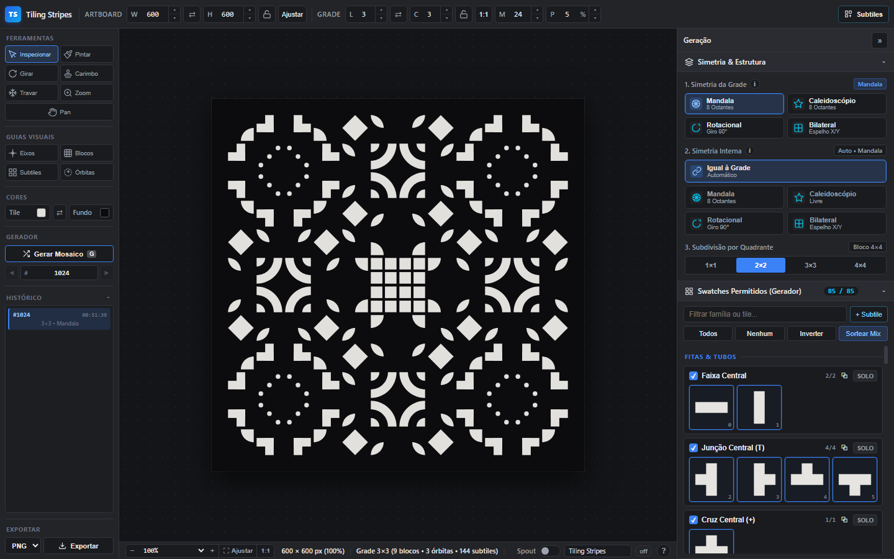
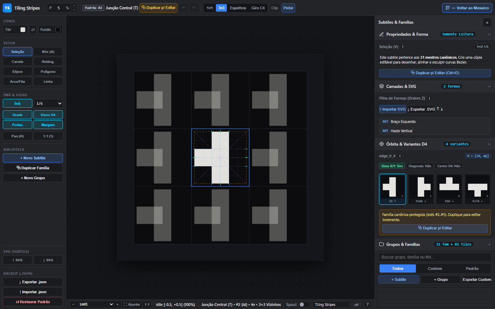
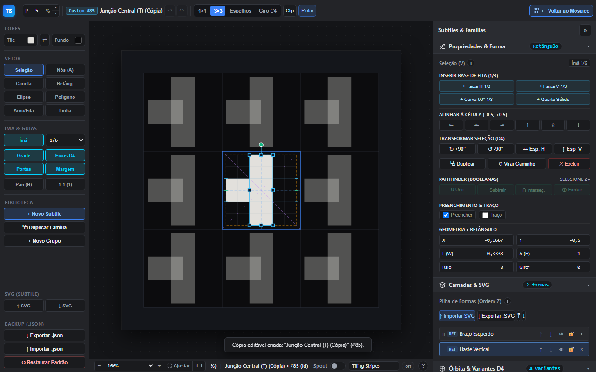
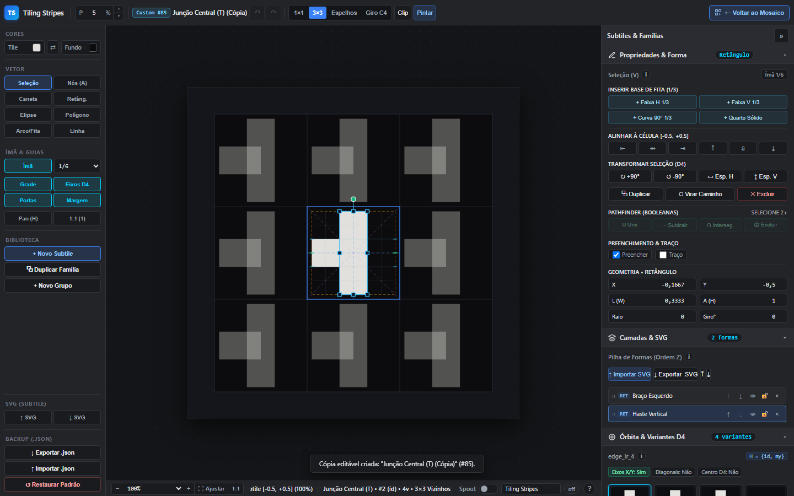
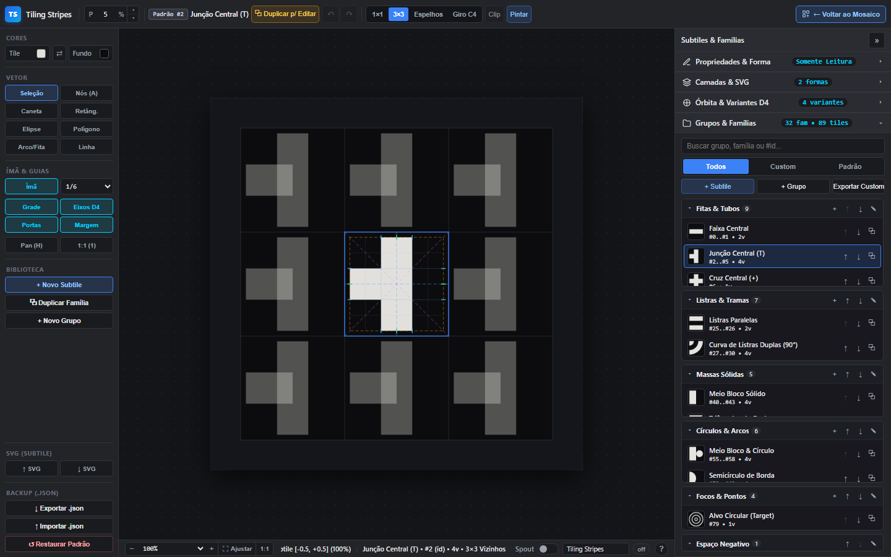
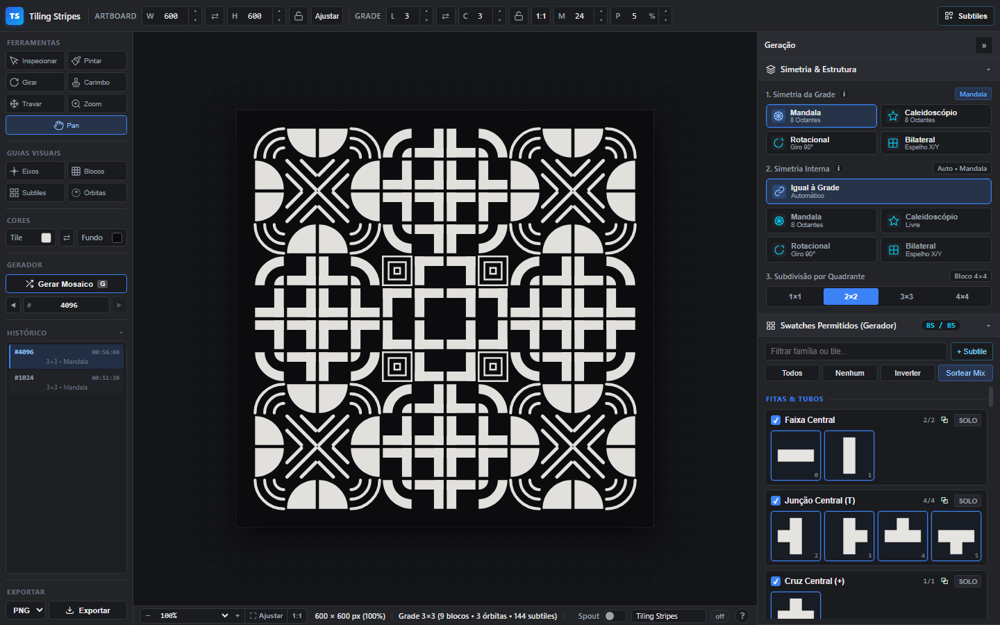
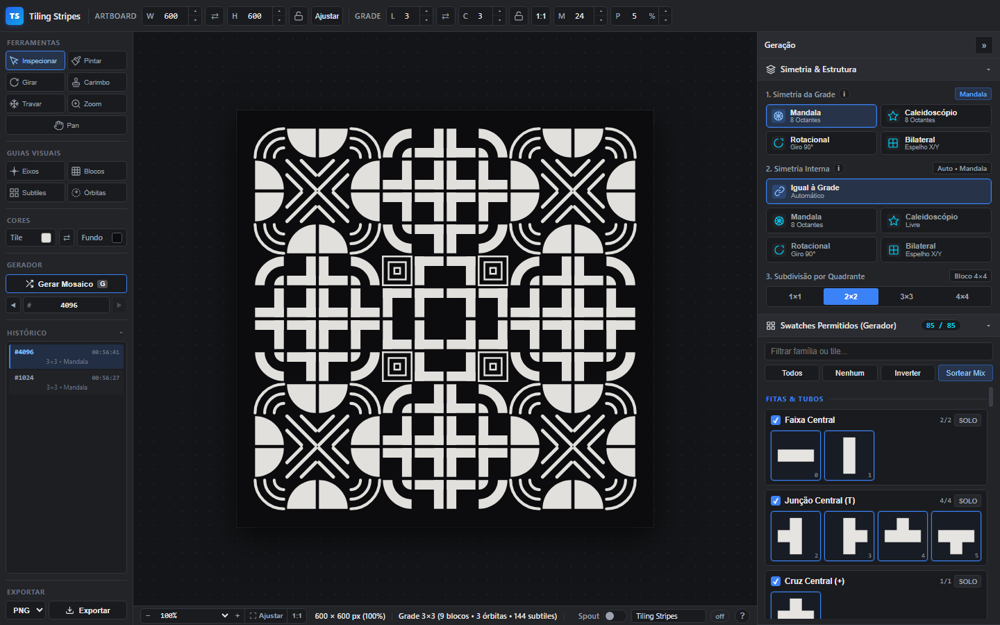

# Revisão técnica e de usabilidade — Subtile Studio (implementação Gemini Argon)

**Data:** 27/10/2026  
**Branch revisada:** `feature/subtile-creator`  
**Commits analisados:** `f806072`, `25f5177`, `6e15441`, `f691234`  
**Base anterior:** `f66a0f1`  
**Escopo:** Fase 0, Fase A (motor JSON/D4), Fase B (modo Subtiles e biblioteca), Fase C (editor vetorial), Fase D (booleanas, camadas e SVG), além de testes, documentação e integração com `sketch.js`.

---

## 1. Veredito executivo

O trabalho tem **qualidade de engenharia acima da média no motor** e um escopo funcional muito grande. A álgebra D4, o compilador da biblioteca, o editor vetorial e as operações booleanas estão bem cobertos por testes e preservam o desenho anterior sem regressão visual.

A **interface do Estúdio de Subtiles, porém, não está pronta para uso**. Há três bloqueadores objetivos:

1. **A biblioteca de grupos e famílias fica cortada e sem rolagem** em 1440×900 e desaparece em 1280×800.
2. **A ferramenta Pan (e o Zoom) no modo Subtiles desativa permanentemente a edição vetorial**, sem indicação visual e sem caminho óbvio de volta.
3. **A seleção de formas vaza de uma família para outra**, podendo fazer o usuário apagar ou transformar a forma errada.

Além disso, a implementação **viola a regra de não usar emojis na interface** (olho, cadeado aberto e cadeado fechado nos botões de camada e no texto de ajuda), e o painel de atalhos exibe uma informação **factualmente errada** sobre as teclas 1 a 6.

**Resumo por área:**

| Área | Avaliação | Comentário |
|---|---|---|
| Álgebra D4, compilador e catálogo | 9/10 | 44/44 testes; paridade visual pixel a pixel com a versão anterior no mesmo seed. |
| Editor vetorial e booleanas | 8/10 | Motor sólido e testado; falta acabamento de interação e desempenho. |
| Biblioteca de grupos/famílias | 3/10 | Funciona nos testes puros, mas o painel real está cortado e sem rolagem. |
| Interface e usabilidade | 5/10 | Muitas ações redundantes, hierarquia confusa, textos de 9 a 10,5 px, erros de estado. |
| Acessibilidade | 4/10 | Sem foco preso nos modais; famílias e camadas não são operáveis por teclado. |
| Testes | 5/10 | Excelentes testes de motor; nenhum teste real de navegador, layout ou interação. |
| Documentação e contratos | 4/10 | `GEMINI.md`, README e manual divergem do código em pontos críticos. |

**Conclusão:** é um **alpha avançado do motor** com uma **interface beta quebrada**. Não recomendo considerar a fase concluída antes de corrigir os três bloqueadores e a conformidade de emojis.

---

## 2. O que foi entregue

| Fase | Commit | Entrega principal |
|---|---|---|
| 0 + A | `f806072` | Motor vetorial JSON, detecção D4, compilador, LibraryStore, renderer, refatoração do `tile_registry.js`, persistência e Spout. |
| B | `25f5177` | Modo `data-studio-mode="tiles"`, gerenciador de grupos/famílias, preview D4, CRUD e importação/exportação JSON. |
| C | `6e15441` | Editor vetorial interativo com 8 ferramentas, seleção BBox, nós Bezier, caneta, snap, undo/redo e clipboard. |
| D | `f691234` | Booleanas Paper.js, transformações D4 na seleção, painel de camadas, importação/exportação SVG e testes. |

Volume: **30 arquivos**, **+15.615 / -1.382 linhas** entre `f66a0f1` e `HEAD`.  
Arquivos novos relevantes: `core/subtile_studio_ui.js` (3.588 linhas), `core/vector_editor.js` (2.725), `core/vector_boolean.js` (1.323), `core/library_store.js` (860), `core/d4_detect.js` (657), `core/vector_renderer.js` (623), `core/tile_library.js` (579).

---

## 3. Método da revisão

- Leitura integral dos módulos novos e dos pontos de integração em `index.html`, `sketch.js`, `style.css`, `ui_info.js` e `GEMINI.md`.
- Execução dos **44 testes**: `node tests/run_all.js` não funciona sob o sandbox atual porque o runner usa `spawnSync` com pipes (EPERM). Cada uma das 44 suítes foi executada individualmente com `node`; **44/44 passaram**.
- Inspeção real em navegador: Microsoft Edge 155 headless via CDP, em **1440×900** e **1280×800**, com captura de tela, medição de layout, interação com mouse/teclado e leitura do console.
- Varredura estática de emojis/pictogramas em `index.html`, `style.css`, `sketch.js`, `ui_info.js`, `core/` e documentação.
- Testes de estado: troca de família com seleção ativa, Pan seguido de Seleção, abertura de modal e Tab, exportação/importação SVG com padding, e medição de tempo de uma edição de forma.
- Nenhum arquivo de produção foi alterado nesta revisão.

**Console do navegador:** nenhum erro ou exceção JavaScript durante os fluxos testados.

---

## 4. O que funciona bem

- **Paridade visual:** no seed 4096, o artboard atual e o da versão `f66a0f1` são **idênticos pixel a pixel** na área do mosaico (comparação de 90.000 amostras, diferença 0). A refatoração do catálogo não regrediu o desenho.
- **D4 e compilador:** os 85 tiles built-in, as 31 famílias e os 680 mapeamentos D4 passam nos testes; o Tile Vazio continua em `#84`; as famílias customizadas são compiladas com órbitas corretas.
- **Editor vetorial:** ferramentas, nós Bezier, subdivisão de Casteljau, snap, histórico por família e clipboard passam nos testes de operação.
- **Booleanas e SVG:** união, subtração, interseção, XOR, furos `evenodd`, transformações D4, camadas e importação de primitivas SVG passam nos testes.
- **Layout macro:** em 1440 e 1280 não há rolagem horizontal; as quatro zonas (topo, barra esquerda, viewport, dock) mantêm as larguras previstas (192 px, 350 px, etc.).
- **Gaveta do dock:** o recolhimento para 44 px funciona e libera espaço para o canvas.
- **Acessibilidade básica existente:** vários botões têm `aria-pressed`, os painéis têm `aria-expanded`, há `:focus-visible` global e respeito a `prefers-reduced-motion`.

---

## 5. Bloqueadores (P0)

### P0-1 — A biblioteca de grupos e famílias está cortada e não rola

**Impacto:** o recurso central da Fase B — escolher, criar, renomear, arrastar e excluir famílias — fica inutilizável na prática.

**Evidência medida:**

| Viewport | Altura do painel da biblioteca | Altura útil da lista | Observação |
|---|---:|---:|---|
| 1440×900 | 204 px | **57 px** | Cabe aproximadamente uma linha de família. |
| 1280×800 | 131 px | **0 px** | A lista não aparece. |

Em 1440, os quatro painéis abertos (Propriedades 152 px, Camadas 168 px, Órbita D4 292 px, Biblioteca 204 px) consomem todo o dock de 854 px. Em 1280, o painel da biblioteca começa em `y=669` e termina em `y=800`, mas o cabeçalho e a barra de busca/filtros consomem os 131 px, deixando **zero** para a lista.

Além disso, mesmo quando os outros três painéis são recolhidos e a lista ganha 570 px, os blocos de grupo encolhem porque são itens flexíveis:

- `.lib-mgr-tree-scroll` é `display:flex; flex-direction:column` ([style.css:3817](style.css#L3817-L3821)).
- `.lib-group-block` tem `overflow:hidden` e **`flex-shrink:1` padrão** ([style.css:3823](style.css#L3823-L3828)).
- Medição: o grupo "Fitas & Tubos" tem 8 famílias, mas o bloco foi comprimido para 131 px enquanto a lista interna tem 324 px; `scrollHeight` do bloco (354) é maior que `clientHeight` (129), e o `scrollHeight` da árvore (570) é igual ao `clientHeight` (570). Ou seja: **a árvore não rola e o conteúdo é cortado**.
- Ao injetar `flex-shrink:0` nos blocos, o `scrollHeight` da árvore sobe para 1.486 px e todas as famílias ficam acessíveis. Isso confirma a causa.

**Capturas:** [02 — 1440, biblioteca sem lista](assets/revisao_argon/02_subtiles_1440_biblioteca_cortada.png), [03 — 1280, painel cortado](assets/revisao_argon/03_subtiles_1280_painel_cortado.png), [05 — biblioteca expandida e ainda cortada](assets/revisao_argon/05_biblioteca_expandida_cortada.png).

**Correção mínima:**

```css
.lib-group-block {
  flex-shrink: 0;
}
```

**Correção estrutural recomendada:** dar à biblioteca uma altura mínima real (por exemplo, 260 a 320 px), permitir rolagem do conjunto do dock ou transformar os quatro painéis em abas (Forma / Camadas / Órbita / Biblioteca). Recolher "Propriedades" e "Camadas" por padrão ao entrar no Estúdio também melhora bastante a primeira impressão.

**Arquivos:** [index.html:1029-1194](index.html#L1029-L1194), [style.css:931-940](style.css#L931-L940), [style.css:1732-1738](style.css#L1732-L1738), [style.css:3817-3828](style.css#L3817-L3828).

---

### P0-2 — Pan/Zoom no Estúdio desativa a edição vetorial e não há volta

**Impacto:** depois de usar o botão "Pan (H)" ou a tecla `Z` no modo Subtiles, clicar em qualquer ferramenta vetorial **não devolve a capacidade de desenhar**. O usuário pode passar minutos achando que o editor quebrou.

**Causa:**

- `handleCanvasMouseDown` só encaminha eventos ao editor vetorial se `StudioState.activeTool` **não** for `pan` nem `zoom` ([sketch.js:2408-2418](sketch.js#L2408-L2418)).
- O botão `btnTileViewPan` chama `hostCtx.setActiveTool('pan')` ([core/subtile_studio_ui.js:3100-3104](core/subtile_studio_ui.js#L3100-L3104)).
- Os botões vetoriais chamam apenas `setVectorTool`, que altera `VectorEditor.state.activeTool` e **não** altera `StudioState.activeTool` ([core/subtile_studio_ui.js:481-501](core/subtile_studio_ui.js#L481-L501)).

**Teste real:** após clicar em Pan e depois em Seleção, o estado medido foi:

```text
activeTool: "pan"
vectorTool: "select"
btnTileViewPan.aria-pressed: null
btnTileViewPan.active: false
```

O botão Pan também **não expõe estado nenhum**: não tem `aria-pressed`, não recebe a classe `active` e não indica que está ligado. Pior: `setActiveTool('pan')` também é usado ao sair do Estúdio, então o mosaico volta com a ferramenta Pan ativa.

**Correção recomendada:** separar o conceito de "ferramenta do mosaico" do "modo de navegação do Estúdio". O Pan do Estúdio deve ser temporário (espaço/botão do meio) ou um estado local com `aria-pressed`, e qualquer clique em ferramenta vetorial deve restaurar a edição. Ao fechar o Estúdio, restaurar a ferramenta anterior do mosaico. Alternativa mínima: em `setVectorTool`, chamar `hostCtx.setActiveTool('inspect')` quando o modo for `tiles`.

**Arquivos:** [sketch.js:2408-2418](sketch.js#L2408-L2418), [core/subtile_studio_ui.js:481-501](core/subtile_studio_ui.js#L481-L501), [core/subtile_studio_ui.js:3100-3104](core/subtile_studio_ui.js#L3100-L3104).

---

### P0-3 — A seleção de formas vaza entre famílias e pode corromper outra família

**Impacto:** o usuário seleciona uma forma na família A, troca para a família B e a forma `s1` de B já está selecionada. Um `Delete`, uma seta, um alinhamento ou uma transformação D4 age sobre a forma errada.

**Causa:**

`resetTransientForFamilySwitch` só limpa a seleção se `workingFamilyId` estiver definido e for diferente da nova família ([core/vector_editor.js:1986-1996](core/vector_editor.js#L1986-L1996)). Depois de um clique normal, `workingFamilyId` é `null`; logo, a limpeza **não acontece**. `selectFamily` chama esse reset e depois apenas atualiza o id ([core/subtile_studio_ui.js:470-479](core/subtile_studio_ui.js#L470-L479)).

Como **todas as 30 famílias built-in não vazias possuem uma forma `s1`** (algumas usam também `s2`, `s3` e `s4`) ([core/tile_library.js:35](core/tile_library.js#L35)) e as famílias criadas pela UI também começam com `s1` ([core/library_store.js:556-560](core/library_store.js#L556-L560)), a seleção antiga encontra uma forma homônima na nova família.

**Teste real:** família customizada A, forma `s1` selecionada; clique na família customizada B:

```text
Família B: custom-fam-b
Seleção: ["s1"]
Badge: "Retângulo"
Formas de B: ["s1", "s2"]
```

O mesmo risco existe após excluir a família selecionada, restaurar a biblioteca ou importar um pacote que troque os IDs.

**Correção recomendada:** manter um `currentFamilyId` explícito no estado do editor e limpar `selectedShapeIds`, `selectedNodes`, `penSession`, `workingShapes`, `dragOp` e `activeSnapGuides` **sempre** que a família mudar; limpar também ao excluir/restaurar/importar. Nunca depender de `workingFamilyId` para detectar troca.

**Arquivos:** [core/vector_editor.js:1986-1996](core/vector_editor.js#L1986-L1996), [core/subtile_studio_ui.js:470-479](core/subtile_studio_ui.js#L470-L479), [core/library_store.js:556-560](core/library_store.js#L556-L560).

---

## 6. Problemas de alta prioridade (P1)

### P1-1 — Desempenho: cada edição de forma custa cerca de 300 ms

Uma única alternância de visibilidade de forma levou **278,6 ms**, e as três seguintes **319,1 / 300,1 / 288,6 ms**, com 89 tiles na biblioteca. A reconstrução de miniaturas sozinha levou **69,4 ms**.

**Causa:** cada `commitFamilyShapes` dispara `LibraryStore.onChange`, que executa, de forma síncrona:

- `buildTileThumbnails()` — recria um `p5.Graphics` e um `toDataURL()` para **todos** os tiles ([sketch.js:1467-1496](sketch.js#L1467-L1496));
- `renderSwatchesPanel()` — reconstrói todos os swatches;
- `renderEditBrushPalette()`;
- `renderSupertileBuilderCanvas()`;
- `SubtileStudioUI.refresh()` — reconstrói a árvore inteira de grupos/famílias, o painel D4, as camadas e as propriedades ([core/subtile_studio_ui.js:2599-2608](core/subtile_studio_ui.js#L2599-L2608));
- além do listener em [sketch.js:701-723](sketch.js#L701-L723).

O usuário sente um congelamento de ~0,3 s a cada ajuste. Com mais famílias customizadas (8 variantes cada), isso piora proporcionalmente. A reconstrução da árvore também deve ser a causa de saltos de rolagem quando a lista voltar a rolar.

**Correção recomendada:** separar eventos (`family-shapes-changed`, `library-structure-changed`, `brush-changed`), reconstruir miniaturas apenas para a família alterada, agendar miniaturas com `requestIdleCallback`/debounce, e atualizar apenas os painéis afetados em vez de chamar `refresh()` completo. Medir novamente com 85, 150 e 300 tiles.

---

### P1-2 — Exportar e reimportar SVG encolhe a geometria

O export usa o `paddingRatio` do mosaico (5% por padrão) dentro de um `viewBox` de 1000×1000 ([core/vector_boolean.js:1249-1283](core/vector_boolean.js#L1249-L1283)). O import mapeia o `viewBox` inteiro para `[-0.5, 0.5]`, então a margem vira encolhimento.

**Teste real:** família `center-stripe`, exportação e reimportação:

```text
Antes:  largura 1.0000, altura 0.3333
Depois: largura 0.9000, altura 0.3000
Padding: 0.05
```

Cada ciclo exportar/importar reduz 10% na largura e na altura. O botão diz "SVG unitário limpo", mas o arquivo não é unitário quando o padding é maior que zero.

**Correção recomendada:** exportar com padding 0 por padrão (e oferecer uma opção explícita "incluir respiro"), ou gravar o padding como metadado e compensá-lo no import. Adicionar um teste de round-trip com o padding padrão da UI, não apenas com padding zero.

**Arquivos:** [core/subtile_studio_ui.js:688-727](core/subtile_studio_ui.js#L688-L727), [core/vector_boolean.js:1249-1283](core/vector_boolean.js#L1249-L1283).

---

### P1-3 — Operações destrutivas da biblioteca sem rede de segurança

Quatro caminhos podem destruir trabalho sem desfazer:

1. **Importar com modo "Substituir"**: o modo escolhido na última abertura do modal **permanece selecionado** (`openImportModal` não reseta os radios), o foco inicial vai para "Importar" ([core/subtile_studio_ui.js:601-624](core/subtile_studio_ui.js#L601-L624)), e não há segunda confirmação. O texto não avisa que as famílias customizadas atuais serão removidas e que células do mosaico virarão `#84`.
2. **Excluir família**: confirma, mas não há undo; as células são imediatamente tombstone para `#84` ([core/subtile_studio_ui.js:915-958](core/subtile_studio_ui.js#L915-L958)).
3. **Restaurar padrão**: idem, sem undo e sem backup automático ([core/subtile_studio_ui.js:960-986](core/subtile_studio_ui.js#L960-L986)).
4. **SOLO**: limpa `allowedTiles`, regenera o mosaico e fecha o Estúdio sem passar pelo `dirtyGuardDialog` ([core/subtile_studio_ui.js:3221-3231](core/subtile_studio_ui.js#L3221-L3231)). O histórico pode recuperar em alguns casos, mas o usuário não é avisado.

**Correção recomendada:** antes de substituir/restaurar, exportar automaticamente um backup JSON; resetar o modo do modal para "Mesclar" a cada abertura; confirmar "Substituir" em um segundo passo; adicionar undo de biblioteca (snapshot do documento anterior) ou pelo menos um "Desfazer última operação de biblioteca"; usar o dirty guard no SOLO.

---

### P1-4 — Modais sem foco preso e com foco inicial perigoso

O `role="dialog"` e `aria-modal="true"` existem, mas não há trap de foco, `inert` no fundo, nem restauração de foco ao fechar ([core/subtile_studio_ui.js:568-660](core/subtile_studio_ui.js#L568-L660)).

**Teste real:** com o modal de importação aberto e foco em "Importar", um único `Tab` levou o foco para `fgColorPicker`, **fora do diálogo**. O teste retornou:

```text
active: "fgColorPicker"
inside dialog: false
```

Além disso:

- o foco inicial do modal de importação é o botão **Importar** (ação destrutiva), não "Cancelar";
- `Escape` não fecha o modal quando o foco está em um `<select>`, porque o listener global ignora `SELECT`;
- o foco não volta ao botão que abriu o modal.

**Correção recomendada:** trap de Tab/Shift+Tab, foco inicial em "Cancelar", `inert`/`aria-hidden` no restante da aplicação, restauração do foco e tratamento de `Escape` no próprio diálogo.

---

### P1-5 — Famílias e camadas não são operáveis por teclado

As linhas de família são `<div>` com `click` e `draggable`, sem `tabindex`, `role` ou tratamento de Enter/Espaço ([core/subtile_studio_ui.js:1500-1703](core/subtile_studio_ui.js#L1500-L1703)). As linhas de camada têm o mesmo problema ([core/subtile_studio_ui.js:2384-2597](core/subtile_studio_ui.js#L2384-L2597)).

Um usuário de teclado/leitor de tela:

- não consegue **selecionar** uma família na biblioteca;
- não consegue **selecionar** uma forma na lista de camadas;
- ouve o nome acessível dos botões de camada como o emoji (`U+1F441`, `U+1F512`, `U+1F513`), não como "Ocultar forma" / "Travar forma";
- não recebe `aria-pressed` no botão Pan;
- nos botões de alinhamento, depende apenas de `title` (ícones `⇤`, `⇹`, `⇥`, `⤒`, `⇳`, `⤓`).

**Correção recomendada:** `role="option"`/`treeitem` com `tabindex`, Enter/Espaço para selecionar, setas para navegar; `aria-label` em todos os botões de ícone; `aria-pressed` no Pan; texto ou rótulo visível nos alinhamentos.

---

### P1-6 — Violação da regra de não usar emojis na interface

Há emojis reais renderizados na interface:

| Local | Emoji | Código |
|---|---|---|
| Botão de visibilidade das camadas | olho | `U+1F441` ([core/subtile_studio_ui.js:2548](core/subtile_studio_ui.js#L2548)) |
| Botão de trava das camadas | cadeado fechado / aberto | `U+1F512` / `U+1F513` ([core/subtile_studio_ui.js:2563](core/subtile_studio_ui.js#L2563)) |
| Texto de ajuda "Booleanas, Camadas & SVG" | olho e cadeado | `U+1F441` / `U+1F512` ([ui_info.js:180](ui_info.js#L180)) |

O texto de ajuda é exibido no popover da interface, portanto também é interface. A documentação (`README.md`, linhas 84 a 91) usa ainda outros emojis de pictograma (`U+1F50D`, `U+1F9F9`, `U+1F512`, `U+270B`, `U+1F50E`).

Também há vários dingbats textuais usados como ícones (`U+270E`, `U+29C9`, `U+2715`, `U+2713`, `U+21BA`, `U+21C4`, `U+2912`, `U+2913`). Eles não são emojis coloridos, mas fogem do padrão de ícones SVG adotado no restante do app.

**Correção recomendada:** substituir olho/cadeado por SVG inline (ou pelos ícones já usados no restante da UI), remover emojis do texto de ajuda e da documentação, e adicionar um teste que varra `index.html`, `ui_info.js`, `core/` e `README.md` por propriedades emoji, falhando o build.

---

### P1-7 — O painel de ajuda ensina atalhos que não existem

O runtime exibe:

```text
"1 a 6: Seleciona Escopo de Edição (Centro do Canvas (1), Órbita (2), ...)"
```

Mas o comportamento real é: `1` = zoom 100%, `0` = ajustar à janela, `Q`/`Tab` = ciclar escopos; `1` a `6` não selecionam escopos ([sketch.js:4286-4303](sketch.js#L4286-L4303)).

**Causa:** o texto correto em `ui_info.js` diz "Q ou Tab ... (antigos atalhos 1 a 6 removidos)" ([ui_info.js:133](ui_info.js#L133)). `syncScopeTopics` procura qualquer linha que contenha "1 a 6" e **substitui** essa linha por "1 a 6: Seleciona Escopo..." ([ui_info.js:225-229](ui_info.js#L225-L229)). O teste `test_info_scopes_source.js` ainda **exige** a presença da linha "1 a 6", consagrando o erro ([tests/test_info_scopes_source.js:64-70](tests/test_info_scopes_source.js#L64-L70)).

**Correção recomendada:** trocar o texto/gerador para `Q / Tab` e atualizar o teste para validar essa afirmação, além de um teste que compare os atalhos documentados com o handler real.

---

### P1-8 — Falha de persistência da biblioteca é silenciosa

A biblioteca customizada é um ativo caro. Em `LibraryStore.persistCurrentDoc`, erros de quota do `localStorage` são engolidos e falhas do IndexedDB são descartadas com `.catch(() => {})` ([core/library_store.js:315-336](core/library_store.js#L315-L336)). Não há aviso, retry ou cópia de emergência.

Se a cota estourar e o IndexedDB falhar, o usuário pode fechar a aba acreditando que o trabalho foi salvo. O estado do mosaico tem `#persistenceWarning`; a biblioteca não tem equivalente.

**Correção recomendada:** propagar o erro para a UI, mostrar um aviso persistente, tentar um payload reduzido/backup e sugerir exportar o JSON.

---

## 7. Problemas médios (P2)

### P2-1 — O preview "3×3 vizinhos" não mostra vizinhos reais

`computePreviewCells('neighbors_3x3', t0)` usa **a mesma transformação `t0` nas 9 células** ([core/subtile_studio_ui.js:241-254](core/subtile_studio_ui.js#L241-L254)). O resultado é o mesmo tile repetido 9 vezes, não os tiles/orientações que o mosaico usaria ao redor. O rótulo da barra de status diz "3×3 Vizinhos" ([core/subtile_studio_ui.js:2971](core/subtile_studio_ui.js#L2971)), o que promete uma verificação de emendas que o modo não oferece.

**Recomendação:** usar as transformações reais dos vizinhos a partir do `mosaicData`/D4, ou renomear para "repetição 3×3" e deixar claro que é um preview de wallpaper.

### P2-2 — Barra superior com controle órfão e hierarquia invertida

Em modo Subtiles, a barra superior mostra apenas o chip `P 5 %` da Grade; os demais controles de grade estão ocultos, mas o `paddingInput` não tem a classe `mosaic-mode-only` ([index.html:62-110](index.html#L62-L110)). O resultado é um controle solto, sem o rótulo "Grade" e sem contexto, em 1440 e 1280 ([style.css:3377-3379](style.css#L3377-L3379)).

Na barra esquerda, a seção **Cores** aparece **antes** de Vetor, porque não é oculta no modo tiles ([index.html:347-366](index.html#L347-L366)); as ferramentas vetoriais começam abaixo dela. A primeira ação visual do Estúdio deveria ser a ferramenta/família, não a cor global do mosaico.

**Recomendação:** esconder a Grade inteira no modo tiles e mover o respiro para o painel do preview; mover Cores para o fim ou ocultar no modo tiles.

### P2-3 — Ações redundantes e nomenclatura inconsistente

Há várias portas para a mesma ação:

- duplicar família: `#btnTileTopDuplicate`, `#btnRailDuplicateSubtile`, `#btnNoticeDuplicateToEdit`, `#btnPropsDuplicateBuiltIn` e o botão `⧉` de cada linha;
- importar SVG: `#btnImportSubtileSvg` e `#btnLayersImportSvg`;
- exportar SVG: `#btnExportSubtileSvg` e `#btnLayersExportSvg`;
- "Pintar": `#btnTileTestInMosaic`, `#btnUseActiveInBrush` e o botão do card de metadados;
- novo subtile/grupo: rail e barra do gerenciador.

Isso aumenta a carga cognitiva e a chance de divergência. Termos misturam português e inglês (`Clip`, `SOLO`, `Custom`, `Padding`, `Pathfinder`, `Backup`, `Reset`), e "Excluir" é usado tanto para apagar forma quanto para a operação booleana XOR, o que é ambíguo.

**Recomendação:** escolher um único ponto de entrada por ação (provavelmente o gerenciador) e remover os atalhos duplicados; padronizar "Recortar", "Isolar", "Personalizado", "Respiro", "Combinar formas" e "Diferença (XOR)".

### P2-4 — Tipografia e densidade

A interface usa 9 px a 10,5 px em muitos textos operacionais: rótulos de ferramenta (10 px), metadados de família (9 px), tags de camada (9 px), botões de grupo (9,5 px) e o painel D4. Em 1440 e 1280 isso é legível apenas com esforço, e o painel direito de 350 px fica muito denso.

**Recomendação:** elevar o corpo mínimo para 11,5 a 12 px, reduzir a quantidade de informação simultânea e usar divulgação progressiva para metadados menos usados.

### P2-5 — Criar/importar item com busca/filtro ativo pode esconder o resultado

`handleCreateGroup` e `handleCreateFamily` não limpam `uiState.searchQuery`; `handleCreateFamily` ajusta apenas o filtro `builtin` ([core/subtile_studio_ui.js:805-876](core/subtile_studio_ui.js#L805-L876)). Se houver uma busca ativa, o novo grupo/família é criado, o toast aparece, mas a linha não é renderizada. O mesmo ocorre após `closeImportModal` ([core/subtile_studio_ui.js:626-660](core/subtile_studio_ui.js#L626-L660)) e após `handleResetLibraryDefaults`, que não reseta o filtro `custom` ([core/subtile_studio_ui.js:960-986](core/subtile_studio_ui.js#L960-L986)).

**Recomendação:** limpar busca/filtro ao criar/importar/restaurar e garantir que o item selecionado seja revelado e rolado para a vista.

### P2-6 — Rolagem e foco da árvore são perdidos a cada `refresh()`

`renderLibraryManagerTree` faz `container.innerHTML = ''` e reconstrói tudo ([core/subtile_studio_ui.js:1269-1704](core/subtile_studio_ui.js#L1269-L1704)); `refresh()` é chamado a cada commit de forma ([core/subtile_studio_ui.js:2599-2608](core/subtile_studio_ui.js#L2599-L2608)). Depois de corrigir o `flex-shrink`, a posição de rolagem e o item selecionado ainda vão saltar para o topo em cada edição. Preservar `scrollTop` e rolar o item ativo para a vista.

### P2-7 — Biblioteca sem desfazer e histórico vetorial órfão

Não há undo para criar/renomear/mover/excluir grupos ou famílias. Além disso, ao excluir uma família, `VectorEditor.histories` não é limpo; se um novo família reutilizar o mesmo slug, o histórico antigo pode reaparecer ([core/vector_editor.js:1555-1617](core/vector_editor.js#L1555-L1617), [core/library_store.js:667-679](core/library_store.js#L667-L679)). Limpar o histórico ao excluir/importar/restaurar e adicionar undo de biblioteca.

### P2-8 — Grupos built-in são renomeáveis/reordenáveis e cópias vão para grupos built-in

`renameGroup` não bloqueia grupos `builtIn` ([core/library_store.js:483-492](core/library_store.js#L483-L492)); a UI oferece "Renomear grupo" em todos. `duplicateFamily` usa o `groupId` da origem quando não recebe override ([core/library_store.js:582-617](core/library_store.js#L582-L617)), então duplicar "#2" coloca a cópia customizada dentro de "Fitas & Tubos", misturando custom com os 31 mestres. Isso pode ser intencional, mas precisa ser decidido e documentado; hoje a UI não explica.

### P2-9 — Sem ajuste automático abaixo de 1280

O canvas é fixo em `StudioState.width × height` (600×600 no padrão) e o pasteboard usa `overflow:hidden`. Em 1024 px de largura, o viewport útil fica menor que 600 px e o artboard é cortado; não há `ResizeObserver` nem refit automático. O app foi validado apenas em 1280/1440, mas não há fallback para telas menores ou zoom de navegador.

### P2-10 — Código e documentação mortos

- CSS de `#left-rail`, `#workspaceSwitcher` e `.status-guide-btn` sem uso ([style.css:426-490](style.css#L426-L490), [style.css:851-925](style.css#L851-L925), [style.css:2395-2425](style.css#L2395-L2425)).
- `sketch.js` ainda consulta `#editToolSegmented`, que não existe ([sketch.js:3071](sketch.js#L3071), [sketch.js:3751](sketch.js#L3751)).
- O comentário de geografia em [style.css:419-423](style.css#L419-L423) fala de "rail | canvas | tools | dock", mas o layout real é tools | canvas | dock.
- O título da página ainda é "Mosaic Generator", apesar do novo modo.
- `tests/run_all.js` imprime `→` no lugar de `→` ([tests/run_all.js:81](tests/run_all.js#L81)).

---

## 8. Documentação, contratos e testes

### 8.1 Divergências entre regras/documentação e código

| Item | Dito em `GEMINI.md` / docs | Código atual |
|---|---|---|
| Chave do `localStorage` | `tiling_stripes_studio_v3_state` ([GEMINI.md:26](GEMINI.md#L26), [README.md:149](README.md#L149)) | `tiling_stripes_studio_state_v2` ([core/state_persistence.js:8](core/state_persistence.js#L8)); o teste exige v2 ([tests/test_storage_key.js:58](tests/test_storage_key.js#L58)) |
| Banco IndexedDB | `TilingStripesDB_v1` / store `studio_state` ([GEMINI.md:27](GEMINI.md#L27), [README.md:145](README.md#L145)) | `tiling_stripes_studio_db` / `studio_state_store` ([core/state_persistence.js:237-239](core/state_persistence.js#L237-L239)) |
| Quantidade de controles | 60 congelados ([GEMINI.md:21](GEMINI.md#L21), [docs/MANUAL_MANUTENCAO.md:103](docs/MANUAL_MANUTENCAO.md#L103)) | 243 IDs únicos no `index.html`; o registro continua com 60 e não cobre o Estúdio |
| Quantidade de suítes | 36 ([GEMINI.md:51](GEMINI.md#L51)) | 44 ([tests/run_all.js:8-69](tests/run_all.js#L8-L69)) |
| Tópicos de ajuda | 13 ([docs/MANUAL_MANUTENCAO.md:166](docs/MANUAL_MANUTENCAO.md#L166)) | 17 em `ui_info.js` |
| Preview 3×3 | "8 vizinhos fantasmas" ([README.md:96](README.md#L96)) | 9 cópias da mesma transformação |
| SVG unitário | "gera um .svg unitário limpo" ([README.md:99](README.md#L99)) | Exporta com padding de 5% e reimporta 10% menor |
| Pan por Alt+arrasto | [docs/MANUAL_MANUTENCAO.md:148](docs/MANUAL_MANUTENCAO.md#L148) | Não existe; Alt+arrasto captura região |
| Seta do dock | `«` expandido, `»` recolhido ([docs/MANUAL_MANUTENCAO.md:159](docs/MANUAL_MANUTENCAO.md#L159)) | `»` expandido, `«` recolhido ([sketch.js:3979-3982](sketch.js#L3979-L3982)) |

O ponto mais grave é a chave `v3` vs `v2`: um desenvolvedor seguindo `GEMINI.md` pode "corrigir" o código para `v3` e **perder os saves existentes** (ou quebrar a migração). O `test_docs_consistency.js` não detecta isso porque só procura a chave antiga errada `tiling_stripes_studio_v2_state`, não a chave canônica real ([tests/test_docs_consistency.js:31-38](tests/test_docs_consistency.js#L31-L38)).

### 8.2 Cobertura de testes

Os 44 testes são fortes em:

- álgebra D4, compilador, biblioteca e renderer;
- operações puras do editor vetorial;
- booleanas e SVG;
- persistência e histórico;
- contratos estáticos de HTML/CSS.

Eles **não cobrem**:

- layout real em navegador (altura de painéis, overflow, rolagem);
- transição de modo e separação de ferramentas (Pan/Zoom);
- seleção entre famílias;
- foco em modais;
- navegação por teclado na biblioteca/camadas;
- política de emojis;
- round-trip SVG com padding padrão;
- desempenho de edição;
- busca/filtro escondendo itens recém-criados.

O `test_ui_control_registry.js` verifica apenas a **presença** dos 60 IDs antigos, não que os novos controles estejam registrados nem que o total seja 60. O `test_ui_layout_contract.js` continua validando apenas o layout do mosaico. O `test_info_scopes_source.js` valida a linha errada de atalhos. O `test_docs_consistency.js` procura dois trechos proibidos e confirma a existência das 8 funções de persistência, mas **não** valida a chave canônica real, os nomes do IndexedDB nem as contagens de controles/suítes/tópicos.

**Recomendação:** adicionar uma suíte de navegador (mesmo que opcional/CI) para os fluxos P0; um teste de contrato de CSS para alturas mínimas e `flex-shrink`; um teste de atalhos que compare a ajuda ao handler real; um teste de emoji; e um teste de round-trip SVG com `paddingRatio` padrão.

---

## 9. Matriz de prioridade e esforço

| Prioridade | Item | Impacto | Esforço estimado |
|---|---|---|---|
| P0 | Biblioteca cortada/sem rolagem | Bloqueia o recurso principal | 0,5 dia |
| P0 | Pan/Zoom travando a edição | Bloqueia o fluxo principal | 0,5 a 1 dia |
| P0 | Seleção vazando entre famílias | Corrupção de dados | 0,5 dia |
| P1 | Desempenho de ~300 ms por edição | Percepção de qualidade | 1 a 2 dias |
| P1 | SVG encolhendo no round-trip | Perda de geometria | 0,5 dia |
| P1 | Operações destrutivas sem undo/confirmação | Perda de trabalho | 1 a 2 dias |
| P1 | Foco em modais | Acessibilidade | 0,5 dia |
| P1 | Teclado na biblioteca/camadas | Acessibilidade | 1 dia |
| P1 | Emojis + ajuda errada | Conformidade e confiança | 0,5 dia |
| P1 | Persistência silenciosa da biblioteca | Perda de trabalho | 0,5 dia |
| P2 | IA da barra superior, Cores, duplicações | Usabilidade | 1 a 2 dias |
| P2 | Tipografia/densidade | Usabilidade | 0,5 dia |
| P2 | Docs/contratos/testes | Manutenção | 1 dia |

Total realista para deixar o Estúdio apresentável: **6 a 9 dias de trabalho focado**, sendo 1,5 a 2 dias para os P0.

---

## 10. Plano de correção sugerido

1. **Estabilizar o dock (P0-1):** `flex-shrink: 0` nos blocos de grupo, altura mínima para a biblioteca, rolagem do conjunto ou abas; validar em 1280 e 1440 com captura.
2. **Unificar o estado de ferramenta (P0-2):** Pan/Zoom locais ao Estúdio, com estado visual e retorno automático à ferramenta vetorial; restaurar a ferramenta do mosaico ao fechar.
3. **Limpar seleção e sessões ao trocar de família (P0-3):** `currentFamilyId` explícito; limpar também ao excluir, restaurar e importar.
4. **Reduzir o custo de edição (P1-1):** eventos granulares, miniaturas sob demanda/debounce, atualização parcial dos painéis.
5. **Corrigir o round-trip SVG (P1-2):** padding 0 por padrão ou metadado compensado; teste com o padding padrão.
6. **Rede de segurança da biblioteca (P1-3/P1-8):** backup automático antes de substituir/restaurar, segundo passo de confirmação, undo de biblioteca, aviso de falha de persistência e dirty guard no SOLO.
7. **Acessibilidade (P1-4/P1-5):** trap de foco, foco inicial seguro, restauração; linhas de família/camada focáveis; `aria-label` em ícones; estado do Pan.
8. **Conformidade e conteúdo (P1-6/P1-7):** remover emojis, trocar por SVG, corrigir a linha de atalhos e o teste que a valida.
9. **Acabamento (P2):** barra superior, Cores, duplicações, tipografia, busca/filtro, preview 3×3, documentação e testes.

---

## 11. Evidências visuais

### 11.1 Mosaico atual em 1440×900



### 11.2 Estúdio de Subtiles em 1440×900: a biblioteca aparece apenas como cabeçalho



### 11.3 Estúdio de Subtiles em 1280×800: painel D4 cortado e biblioteca fora da vista



### 11.4 Família customizada: o painel de propriedades cresce e empurra a biblioteca



### 11.5 Biblioteca expandida após recolher os outros painéis: grupos ainda comprimidos



### 11.6 Paridade visual com a versão anterior no seed 4096





A área do artboard foi comparada amostrando cada 2 px: **0 diferenças em 90.000 amostras**.

---

## 12. Conclusão

O Gemini Argon entregou um **motor vetorial e matemático sério**, com testes extensos e sem regressão visual. A Fase A/B/C/D é ambiciosa e tecnicamente interessante.

O problema é que a **camada de produto** não acompanhou o motor: a biblioteca está inutilizável no layout padrão, o Pan desliga a edição, a seleção vaza entre famílias e a interface viola a regra de emojis. Os 44 testes verdes dão uma falsa sensação de conclusão porque medem o motor, não a experiência real.

Se os três P0 forem corrigidos e os P1 de segurança/acessibilidade forem tratados, o Estúdio tem potencial para ser uma ferramenta muito boa. No estado atual, eu não o colocaria na mão de um usuário final sem supervisão.
